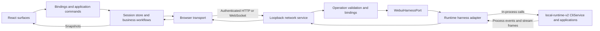
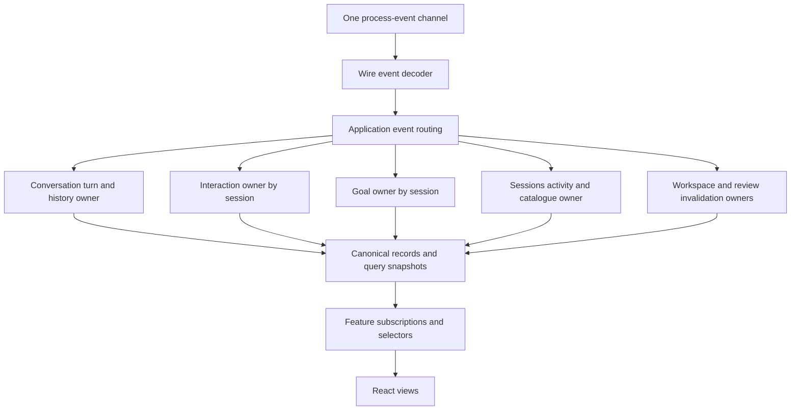

# Plan — WebUI architecture and business module redesign

Status: accepted architecture; specification and development decomposition in preparation. The operator explicitly instructed advancing this Plan to ready-for-development on 2026-10-13. This preparation session does not implement business code or dispatch implementation agents.

Date: 2026-10-13. Source baseline: `5d89bff9c2e25fb79e1278ec276d1fbf17c0882f`, originally on `webui`, with a clean tracked working tree. The proposal is delivered on `docs/webui-architecture-plan`.

## 1. Mandate, evidence and conclusion

Review the complete WebUI architecture, its client business boundaries, and oversized files as one design problem. Existing directories, layering rules and ADRs are evidence of earlier choices, not proof that those choices are optimal. The operator explicitly rejected a minimal-fix or minimal-change framing. Review depth and the recommended destination are not constrained by migration cost. Implementation risks still require an explicit treatment.

The operator confirmed preservation of existing public capabilities and observable behavior, approved business-first physical organization, and delegated technical design convergence to the primary reviewer and the Paseo Lead. After the converged Plan and its data-access boundary were explained, the operator explicitly requested recording decisions, producing the Spec and publishing executable tickets. The [decision record](webui-architecture-decisions.md), [Spec](SPEC-webui-architecture-redesign.md) and [development board](webui-architecture-development-board.md) carry that preparation. No critical design decision remains assigned to the operator.

**Recommendation:** retain the real browser/network/process boundaries, redesign browser application assembly and lifetimes, make business the primary client organization axis, replace presentation-owned reconciliation with application-owned session scopes, and consolidate each authoritative query/command path behind its business owner. Remove identity forwarding and redundant browser reads where they add no semantics. Oversized files are then reorganized by these responsibilities. This is a substantive ownership and dependency redesign, not a directory rename programme.

The present design has useful foundations: a single process-event ingress, generation-fenced stream delivery, separated wire contracts, a process-local harness adapter, framework-free workflows, and frozen protocol comparison tests. Preserve each because of its function and evidence, not because a convention says so. A replacement must offer a better solution to the same responsibilities.

### 1.1 Evidence scope

| Evidence | Actual result and limit |
| --- | --- |
| Source inventory | 309 `.ts`, `.tsx`, `.js` and `.css` files under `packages/webui/src`, 66,992 lines; assets and HTML excluded. 214 client, 43 server, 32 runtime, 20 shared files. This is a structural census, not a claim that every line was manually reviewed. |
| Dependency analysis | Executed `node scripts/check-webui-dependency.mjs --json`: 303 TypeScript source files, 1,099 intra-package references, zero direction violations, zero source import cycles. One accepted non-literal dynamic import in `runtime/mcode-tools-entry.ts:6`. |
| Generated-command gate | Executed `pnpm check:webui-commands`: FAIL, generator still reads `application/turn-capabilities.ts`, while the current home is `application/turn/turn-capabilities.ts`. The stale generator reference also exists at the pinned source baseline; this review changed neither source nor generator. |
| Responsibility review | Traced production assembly, send/resume/history, process events, permission/questionnaire/goal, session selection and deletion, workspace queries/review/terminal, model/provider, plugin catalogue, account/auth, runtime lifecycle, HTTP file/transfer, operation bindings and large-file seams. Source claims below reference current symbols and line anchors. |
| AST census | `WebuiComposer` starts at line 318 and spans 2,143 lines; foundation app starts at 227 and spans 1,416; catalogue starts at 80 and spans 1,129. AST lengths count the declaration, not only executable statements. |
| Executed offline probes | Calling current application modules with a synthetic channel reproduced unregistered-session goal commit suppression. Calling the current query store reproduced different keys overwriting a shared destination field. These prove module behavior; neither drives real sockets, browser storage or a production session. |
| Historical documents | Existing business-reorganization Plan and runtime-layer Plan were read as historical decisions. Their old baseline measurements and completion claims were not substituted for current verification. This proposal does not amend their execution records. |
| Not exercised | No browser/server/provider service was started for this review. No live transport, cloud account, PTY, database, visual parity or performance claim is made. No product code was changed. |

> 🧠 **From Hindsight memory (Component map)** — Prior records describe one browser event ingress, a canonical session store, and a process-local loopback-to-harness boundary. These served as investigation leads; the paths and ownership behavior in this document were checked against current source. The historical layering model was reconsidered rather than adopted as a constraint.

All source paths below are relative to `packages/webui/src` unless another root is stated. Line numbers refer to the baseline above. Facts, reproduced mechanisms, inferred risks, and proposed behavior are explicitly distinguished.

### 1.2 How to read the decisions

Sections 2–3 describe current behavior and root causes. Sections 4–6 define the destination, including boundaries and file treatment. Section 7 records alternatives and adversarial design decisions. Sections 8–10 provide migration inputs, acceptance criteria and evidence limitations. The proposals use concrete directory names to remove placement ambiguity; implementation may choose filenames within those homes without changing the responsibilities or dependency rules.

## 2. Present architecture and actual data paths

### 2.1 Execution topology

The browser-to-loopback hop is a genuine process/network boundary. `runtime/harness/execution.ts:14` delegates into `CliService`, which delegates into conversation applications (`packages/local-runtime-v2/src/local/cli-service.ts:345`; `application/conversation/conversation-application.ts:156,278`). The harness hop is not another network service. WebUI does not execute through the CLI binary or ACP.

`server/service.ts:108` assembles a registry by manually forwarding a large fraction of the runtime port. `server/operation/operation-dispatch.ts:13` validates an envelope, locates a descriptor, validates its body, calls a handler, then serializes a response, error or stream. `runtime/harness/adapter.ts:30` creates the typed port from domain adapters and adds slash-command/session-transfer workflows. Validation, public error mapping, runtime adaptation and host execution are distinct responsibilities; their presence is not intrinsically redundant.

### 2.2 Send, resume and transcript

1. `WebuiComposer` stages input and invokes the React session command binding (`components/composer/WebuiComposer.tsx:318`; `bindings/use-session-state.ts:185`).
2. The binding creates writers, phase/lifecycle commands and a generation-fenced stream sink, then invokes application turn functions. Business orchestration therefore exists both in application modules and in the binding.
3. `mechanisms/stream-loop.ts:451` controls send/resume, cursor recovery and terminal settlement. Pure stream projections reduce frames. History/context recovery transforms are injected, keeping the mechanism independent of presentation.
4. `infrastructure/transport.ts:130` opens one socket per request. Unary calls have a deadline; send/resume streams resolve on `[DONE]`, reject on a premature close, and do not expose a browser-side cancellation handle.
5. Server stream handlers and dispatch adapt an `AsyncIterable` to event frames. Session execution persists and runs in the host; dropping a browser delivery link is not the same operation as aborting the host turn.
6. Canonical history paging lives in `application/transcript/transcript-history.ts:35`. Composer independently calls `loadMessages` to recover context usage (`WebuiComposer.tsx:672`). Stream recovery can also load history. Multiple purposes are legitimate; repeating overlapping reads without a shared request owner is not automatically legitimate.

### 2.3 Process events and reconnect

`main.tsx:98` constructs `createWebuiApplication` inside React `useMemo`; the application constructor opens the event channel immediately (`application/create-application.ts:181`). `infrastructure/event-channel.ts:90` reconnects the long-lived `watchEvents` connection. Acceptance is explicitly not a subscription barrier: server dispatch acknowledges before the first iterator pull, while the host event generator subscribes inside its body (`operation-dispatch.ts:120`; `packages/local-runtime-v2/src/application/events.ts:122`). The process-event stream has no replay cursor in this contract.

The event coordinator is the sole ingress consumer. Its effects route through `application/turn/event-effects-registry.ts:52`, which maps sessions to handlers registered by Composer (`WebuiComposer.tsx:778`). The shell replaces the global effect set and turns workspace-git events into React state, then another effect invalidates workspace queries (`WebuiClientFoundationApp.tsx:1020,1109,1126`). Reconnect recovery combines registered Composer handlers and shell activity probes. One connection exists, but important reconciliation still follows view registration and React scheduling.

### 2.4 Query, state and business organization

The current client uses a technical layer first: `application/<business>`, `components/<business>`, `contracts/<business>` and `projection/<business>`, with shared `bindings` and `mechanisms`. Twelve named business rows exist, including shell and turn. The previous reorganization has already introduced workflows and real port slices; the problem is not a flat, unstructured original tree.

`application/port-slices.ts:321` copies allowed methods into separate objects. This genuinely removes unrelated methods from each object. However, `bindings/port-slices-context.tsx:60` accepts any business name and returns its slice, while `useWebuiPortSlicesOptional` exposes all slices. It is an injection convenience, not a capability-isolation boundary. The comment that callers cannot ask for another business is contradicted by its signature and by Composer asking for goal/interactions.

Framework-free owners for settings, models, plugins and workspace exist. The shell creates these and their providers (`WebuiClientFoundationApp.tsx:338–430`); Composer still creates interaction and goal coordinators (`:497,520`) and separately holds model/account/catalogue query results (`:568,608,964`). Global binding files import many businesses. Directory grouping and ownership changes have progressed unevenly.

Storage truth remains in the host for durable sessions, goals, providers and account credentials. Browser stores hold client projections, cached reads, unread overlays, drafts and presentation state. Treating all browser data as one kind of state would obscure these distinctions.

### 2.5 Other paths that constrain the design

| Path | Current mechanism | Design implication |
| --- | --- | --- |
| Workspace review | `application/workspace/workspace-queries.ts:286` owns working-tree summary/diff/search with snapshot guards. | Workspace snapshot review is not the same resource as a turn changeset. |
| Turn review | `components/transcript/DiffCard.tsx:62,95` reads/mutates a turn diff and keeps a reducer-driven local result. | A transcript surface owns IO that another surface can also consume; introduce an owner, not just a smaller card. |
| Terminal | `server/terminal.ts:11` owns PTYs for the service; `WorkspacePanels.tsx:524` owns xterm/watch attachment. | Process lifetime, delivery lifetime and DOM lifetime must remain separate. |
| Plugin management | One wire operation with an action union and `Record<string, unknown>` input (`shared/plugin-management.ts:1`; server validator at `operation/plugin-management.ts:8`). | Named browser workflows improve caller intent but still need typed internal action/result adaptation. |
| Account | Runtime auth/lease/login and quota clients; browser account workflows and polling. | Browser account state must not become a second token/lease owner. |
| File/transfer HTTP | `server/http/router.ts:29`, `workspace-file.ts:25`, `session-transfer.ts:65,117`. | Preserve range/content/path/auth and transfer behavior when reducing the network service surface. |
| Shutdown | `server/service.ts:369`, `runtime/lifecycle.ts:45`. | Preserve refusal of new operations, connection/iterator cleanup, PTY cleanup and host teardown order. |

## 3. Problems, roots and their relationships

### P1. Browser assembly has multiple effective composition roots

**Fact:** `main.tsx:98` supplies an application. The shell also constructs an application when none is provided (`WebuiClientFoundationApp.tsx:1046`) and constructs most business workflows in either path. The fallback injects unread persistence (`:1062`); the production root does not. `create-application.ts:195` hydrates from whichever adapters were supplied.

**Root:** object ownership is split between entry, shell and mounted business surfaces. Optional/test compatibility is expressed through a second assembly rather than one assembly with explicit capabilities. Business-start side effects occur during render via `useMemo`.

**Impact:** production and standalone fixtures can satisfy different behavior; lifecycle and initialization order are hard to reason about. Render replay/remount leakage is a risk inferred from side-effectful construction, not a browser failure reproduced in this review.

**Destination:** one framework-free assembly, dormant construction, explicit start/dispose, production and fixture adapters exercising the same assembly. Shell lays out already-assembled owners.

### P2. Event ingress is centralized, but business commit/reconciliation authority is mount-dependent

**Fact:** event registry always supplies `setGoal` even when no handler exists for the named session. `event-coordinator.ts:224` detects that function and suppresses its own store fallback. The offline probe emits `thread_goal.updated`: a bare application commits the goal; an application using an empty registry does not. The event spelling is an accepted compatibility branch in `effect-reducer.ts:340`, not evidence that today's runtime emits that spelling.

**Root:** optional callback presence is used as a proxy for business ownership, while the callback silently drops work when a view has not registered. Goal/interaction owners are wired by the component that displays them. Workspace invalidation also makes an unnecessary round trip through shell state.

**Impact:** unmounted-session facts and read-required events have no explicit ownership policy. Reconnect correctness depends on both stream timing and view effects. This is a demonstrated commit-path gap and a broader lifecycle risk; it is not a claim of proven user-visible data loss on every event.

**Destination:** application-installed routing to session-keyed owners. Data-bearing events have a commit owner regardless of visibility; payload-free events invalidate a keyed resource and refresh according to explicit interest. UI subscriptions neither install writers nor start recovery.

### P3. Query destination, identity, freshness and lifecycle are not one contract

**Fact:** `query-store.ts:93` fences completions by arbitrary string key but writes to an independent field. Different keys may write one field and both remain current; an executed probe returns B, then late A, and the field becomes A. Current models callers use a constant key, so this probe proves the abstraction's missing invariant rather than a demonstrated model-picker race. Workspace/account owners implement separate version maps (`workspace-queries.ts:294`; `account-workflows.ts:170`) instead of using the claimed common query mechanism.

**Root:** a state container and a request counter are being treated as a complete query owner. Neither enforces how a destination belongs to an entity/session/view generation, is invalidated by writes, or is disposed.

**Impact:** every caller must reconstruct the missing rules. A reused query helper does not prove consistent ownership; a singleton field may intentionally mean latest selection, but that policy must be explicit.

**Destination:** a small common request/freshness primitive with two explicit uses: a resource keyed by identity, or a selected-view slot fenced by its own generation. Business owners define keys, invalidation and retention. Do not manufacture one global cache for unrelated businesses.

### P4. Business IO and query truth remain duplicated across entry surfaces

**Fact:** models workflow owns its catalogue (`models-workflows.ts:134`), while Composer reads `listModels` into local `models` (`WebuiComposer.tsx:964`) and refreshes it after selection (`:1064`). Composer separately reads plugins, skills and history context. Turn-diff reads/mutations remain in `DiffCard`. Terminal/catalogue/canvas/archive IO remain distributed in workspace components.

**Root:** moving methods behind some workflows has not established one authoritative use-case/query path per resource. Passing named functions as props bypasses interface-level transport guards without changing responsibility.

**Impact:** mutation invalidation, stale-response handling, errors and capability availability vary by surface. Repeated reads and transformations increase conceptual work even when they are cheap at runtime. No request-count or latency improvement is claimed without measurement.

**Destination:** shared feature owners and selectors, with different projections for different surfaces. Share a query only when its key, result coverage and freshness semantics match. History paging and recovery retain distinct modes while sharing compatible in-flight reads and canonical data.

### P5. Layer checks do not enforce business ownership or assembled behavior

**Fact:** current dependency check passes. Its call rules enumerate named capability interfaces (`scripts/lib/webui-dependency-rules.mjs:1560`), and its layer classifier treats components as bindings. Many component capabilities are bare callable props; generic slice access remains allowed. Business dependencies exist in both directions across different files, even though the file import graph has no cycles.

**Root:** physical layering is the main enforced dimension, while architectural ownership is a second, incompletely represented dimension. A green import graph cannot prove correct lifecycle wiring or query ownership.

**Additional verified tooling drift:** `scripts/webui-command-surface.mjs:61` points to the pre-move turn-capabilities path and the command-surface gate fails with ENOENT. The generated business-navigation gate passes. A successful navigation check therefore does not establish that all architecture tooling has followed a move. This source/tool mapping drift is an implementation prerequisite to record, not a change made in this Plan delivery.

**Destination:** check roles inside features, public-vs-private feature imports, named application compositions and explicit cross-business dependencies. Add composition-level behavior tests. A business graph edge is not forbidden merely because it exists; distinguish allowed orchestration from implementation imports and storage writes.

### P6. Node-side forwarding and resource placement obscure the real boundary

**Fact:** `service.ts:140–294` reconstructs most port calls before the typed binding executor maps them again. Some forwards guard optional capabilities and shape errors; others only preserve arguments. `server/terminal.ts` owns native processes despite server being described as a network entrance.

**Root:** network lifecycle, capability projection, native resources and registry assembly have accumulated at one composition point. Public contract mapping is mixed with identity relay.

**Destination:** runtime owns PTY resources; network service receives terminal/runtime ports and a preassembled operation registry. Remove identity relay, preserve explicit optional-capability guards and message/version projections in domain bindings or dedicated adapters. Keep the harness adapter because it isolates host API shape and WebUI semantics.

### P7. Some large modules are policy mixtures; others are cohesive declarations or algorithms

Composer and shell combine multiple businesses and lifetimes. Plugin catalogue combines several forms and resource types. Workspace query owner combines file-tree, content, review and environment state with different identities. Conversely, the 1,064-line binding module is mostly explicit operation declarations; the 846-line token CSS is largely design data. A line-count policy would fragment useful modules while leaving lifecycle problems intact.

`runtime/workspace-archive.ts:1` also implements ZIP/TAR parsing to avoid dependencies. Publishing a package is not an architectural reason to hand-maintain mature format parsers. This is a separate responsibility/dependency decision, not evidence that the parser is currently exploitable. Evaluate mature parsers behind the archive policy contract, with exact supported formats and safety checks preserved.

**Root relationship:** P1 enables P2/P4; P3 makes those flows inconsistent; P5 allows all of them to remain green; P6 increases capability-change propagation; P7 is a symptom in several modules, not the primary cause. Renaming directories alone addresses navigation but none of P1–P6.

## 4. Target architecture: ownership before directories

### 4.1 Browser composition and lifecycle

The browser entry constructs a complete application outside React rendering. Construction is side-effect-free. The assembly creates the session records, feature owners, adapters and routing before any ingress opens. `start(initialRoute)` hydrates persisted browser state and selects the initial session, installs owner routes, then opens the event channel and begins authoritative reconciliation. Initial route parsing must precede unread hydration: pass the selected session ID explicitly to hydration before its first persistence write, so existing mark-read semantics hold. `dispose()` is idempotent and fences pending commits, cancels owned request attachments, stops timers/channel and releases client resources.

Lifecycle states are `constructed -> started -> disposed`. Starting an already-started live instance is idempotent; a disposed instance cannot restart. A remount that requires a new lifecycle constructs a fresh instance/epoch through the same assembly. React effect replay must never reactivate a disposed store. An SSR instance remains constructed and performs no IO.

React receives this instance and provides feature-facing subscriptions/commands. Production boots it once; mount-sensitive hosts use an explicit lifecycle adapter whose setup/cleanup can repeat safely. SSR uses the same dormant assembly and never starts IO. Tests inject partial synthetic capabilities and storage into that assembly. Standalone exported components use an explicit preview/test wrapper; the product shell no longer manufactures a second application.

An unavailable declared capability is a supported state and is exposed as availability plus disabled UI or a typed unavailable outcome. A missing required production owner is an assembly error. Neither case silently reports a successful mutation. Existing documented account-quota degradation remains intentional and distinct from missing wiring.

### 4.2 Conversation substrate and session record repository

Keep one application-owned canonical session-record repository. It stores browser turn/stream/history and feature slices; it does not execute business policy. The aggregate record shape belongs to the application assembly, not to the conversation implementation. Inject narrow writers into the owner of each slice. Presentations receive no writer factory or mutable repository.

The **conversation substrate** owns turn send/attach/stop/retry, stream generations and leases, cursor recovery, history request coordination, and home-to-session turn identity adoption. It publishes commands and stable read models. It has no goal CRUD, plugin/provider logic, rail overlays, shell navigation or React dependencies. Moving history coordination here consolidates the history/recovery invariant; transcript remains the business that requests pages and renders historical/live views.

Goal and interaction owners retain independent policies and fences. Each owns its corresponding record slice through an injected writer. Goal events, command outcomes and authoritative reads commit through the same versioned owner. Permission/questionnaire outcomes use the interaction owner and a narrow turn-phase command interface. Storage co-location is not permission for cross-feature mutation.

Session lifecycle has identity `(applicationEpoch, sessionId)`; stream attempts additionally have `(turnId, generation)`. Purged IDs cannot be resurrected by late events, reads or home adoption. View identity and request identity are separate from resource identity. The initial design does not attach streams for all background sessions.

### 4.3 Session scope, interest and retention rules

The application owns a session-scope manager, independent of component mounting. Selecting a session activates its scope. A workspace tab or explicit command targeting another session can acquire interest in that scope through a named application command; interest is not inferred from incidental React subscriptions. Interest also includes outstanding accepted sends, mutations, pending interaction obligations and reconciliation work. A scope cannot be released merely because navigation changed while it still owns such an obligation. Data-bearing events can update a cheap retained record without starting network IO; only recognized events with valid identity may create a record.

| Situation | Required action |
| --- | --- |
| Data-bearing goal/interaction/progress event | Resolve the live session record and commit through the appropriate owner/fence; if purged, ignore. No view registration is required. |
| Event requires a read, interested session | Mark the exact resource dirty and schedule one owner-controlled read/probe, with completion fences. |
| Event requires a read, uninterested session | Mark resource dirty, retain that marker, and reconcile when interest is acquired. No global background fetch fan-out. |
| Channel accepted/reconnected | Treat as a possible observation gap. Reconcile interested session turn/pending/goal/queue/history freshness and refresh catalogue/activity through their existing authoritative seams. Acceptance does not certify delivery. |
| Session switch | Change interest and selected-view generations; retain current per-session state/drafts according to existing rules. A started turn remains host-owned. Do not equate view switch with host abort or indiscriminately discard a browser attempt that current behavior retains. |
| Session delete | Commit successful deletion, purge canonical record/draft/feature queries, tombstone identity, release relevant client interests and pending commit rights. |
| Page/application dispose | Fence all callbacks; release browser attachments and subscriptions, timers and request handles. Host turn cancellation remains a separate command. |

Use explicit per-resource cleanup on tab close/session delete, plus application disposal. Retention of unvisited session records is initially compatible with current session-store semantics; do not add an arbitrary eviction timeout during structural migration. Key cardinality and memory are measurable follow-up concerns. Dirty markers for resource invalidation must survive view release until reconciled or purged.

Every asynchronous attempt captures a resource identity, owner incarnation and request generation. A commit requires all three to remain current and the resource to be neither purged nor disposed. Releasing view interest may cancel replaceable reads; accepted mutations retain a settlement obligation and report their result through the owning command outcome even if the initiating view has gone. A version guard rejects stale commits but does not cancel IO: the application additionally tracks the actual stream/watch/request disposers. Application disposal closes delivery resources and prevents commits; it does not revoke an already accepted host mutation or abort its execution.

The scope manager tracks separate leases for **selected view**, **explicit secondary consumer**, **delivery attempt**, and **command settlement**. Selection changes release only the selected-view lease. Secondary consumers release their own lease on explicit close. A send/attach delivery lease ends on terminal completion, supersession or explicit delivery detach; a mutation settlement lease ends after its outcome and required invalidation have been committed, or after failure has been recorded. Reconciliation retains a settlement lease until an eligible result covers the requested dirty revision. Purge/application disposal revoke all browser commit rights. Do not evict or recreate an owner/fence while an eligible outstanding completion exists. Explicit delivery detach releases client observation, never host execution. This preserves current independent streams continuing after Composer unregisters its view effects (`WebuiComposer.tsx:797`; `application/turn/turn-commands.ts:83`).

### 4.4 Events: route facts and invalidations to owners

The router is installed by the application assembly, with known domain handlers. Do not replace the current registry with another UI-populated generic event bus. Unknown wire events preserve compatible progress/ignore behavior. Normalize recognized fields once at ingress; domain projections still decide their meaning. Preserve reducer command ordering where observable to streams/progress/interaction settlement and proven by existing tests.

Replace optional callback fallback selection with explicit owner routes and remove the whole-set `setEventEffects` replacement interface. Every accepted domain fact has an owner; every payload-free notification has a dirty/reconcile policy. A goal owner may lazily create its fence when a cheap record is first touched. Reconnect and selection use the same reconciliation entry point, with per-key request coalescing and epoch guards. Coalesce only when resource identity, freshness generation and owner incarnation match. Never join a pre-invalidation read as if it repaired a newer dirty revision; clear the dirty marker only after an eligible result covers that revision. View reactions subscribe after commits and cannot replace authoritative routes.

Event routing may legitimately fan out a workspace-git event to environment and review owners. Owners define invalidation scope. The shell no longer stores a revision only to relay it through a React effect. Small cross-owner workflows are installed explicitly in assembly; an untyped service locator is not the replacement.

### 4.5 Queries, mutations and projections

Use a reusable request guard/snapshot primitive, rather than forcing every feature into one cache schema. The primitive supplies generation tokens, exact commit checks, cancellation/disposal and subscription mechanics. Owners provide identity and policies.

Two safe contracts are supported:

- **Keyed resource:** answers live under a resource key. Session-dependent models include session/agent/provider context that affects the answer; turn review keys include session, turn/changeset identity; workspace review keys include workspace and snapshot. A late answer may populate its own entry but cannot overwrite another entry or view selection.
- **Selected-view slot:** the slot records its owning identity and selection generation. Switching identity invalidates its commit token even if a different resource key is otherwise still current. This is appropriate for the existing active-only queue mirror and single catalogue selection.

Invalidation advances freshness tokens before scheduling a read, so an old in-flight answer cannot mark invalidated data fresh. A mutation commits an outcome once, then invokes the affected owners' explicit invalidation commands. Failure does not become availability loss; optional capability absence does not become success. Retry is bounded by resource policy, not by a universal automatic-retry helper.

Define resource keys as typed tuples/records and serialize in one primitive. Include every response-affecting parameter: session/agent, workspace identity, history cursor/page anchor, review snapshot/changeset, model scope and relevant request options, plus opaque credential/config generations where they affect the answer. Never place credential values in keys exposed to the UI. View/tab identity is not a substitute for resource identity. History owns a per-session/page resource with independent request generations, plus a selected-view generation for presentation. Moving the current singleton selected-session history coordinator unchanged is insufficient for a shared headless/multi-reader seam. Context-only inspection can reuse a compatible history response; stream recovery and older-page pagination cannot be assumed to share one key.

Review mutations publish affected identities. Turn revert/reapply invalidates the corresponding turn resource and the affected workspace environment/review families; applicable workspace/session mutations invalidate affected turn resources or mark them dirty when precise affected IDs are unavailable. Do not refresh unrelated workspaces or reinterpret a workspace snapshot ID as a turn changeset ID. Mutation settlement includes this invalidation obligation.

Multiple readers may subscribe to one owner with stable selected snapshots. The existing prohibition on a second complete session store remains sound; a prohibition on multiple subscriptions is not a reason to combine unrelated state. Common request mechanics do not imply shared business ownership.

Wire DTOs stay in package `shared`. Browser view types stay with the consuming/owning feature or conversation public model. Runtime host types stay runtime-side. Eliminate a transform only when it is identity mapping; retain message/stream, context, review and account projection when semantics differ. Do not make React consume raw host records solely to reduce hop count.

### 4.6 Node service, runtime and transport boundaries

Runtime assembly owns host resources, auth, cloud clients, browser provider, tools broker and PTYs. Moving terminal implementation into runtime does not make it a host-wide shared singleton: one terminal manager belongs to each WebUI service resource scope, with the same explicit-process and service-shutdown lifetime as today. Network service owns bind/origin/auth policy, HTTP/WS connection and iterator lifetimes, byte limits, asset serving and wire dispatch. Inject runtime/terminal ports and a complete registry into it. Registry assembly owns operation-to-capability adaptation, optional-operation behavior, validation and response projections. The host adapter owns translation to the actual in-process API. Preserve the existing terminal/connection/network/host teardown trace; any ordering correction must be separately justified and verified.

No runtime method is selected from a client-supplied property name. Public operation registration remains an explicit allowlist; descriptor completeness and typed argument/result mapping remain enforced. Domain binding tables can be colocated with their descriptors behind a common binding executor. Registry ordering and wire serialization remain deterministic.

Browser transport becomes an adapter with explicit unary, finite stream, long-lived process-event and terminal-watch lifetimes. Factor domain method tables away from wire mechanics and use shared operation identifiers. Keep the current connection topology during the behavior-preserving redesign: independent request/stream links and one process-event link. Changing to multiplexing or HTTP unary is a separate protocol/topology decision requiring evidence, not a prerequisite for feature cohesion.

Add internal delivery handles so application disposal can close its owned browser links and suppress callbacks. Local cancellation must not be translated into host abort. If public interfaces gain an optional local `AbortSignal`, document it as client-delivery cancellation and compare existing call behavior. Preserve `[DONE]`, cursor, error, acknowledgement and terminal-watch semantics. Flow control is a specified follow-up seam: current dispatcher uses `ws.send` without a bounded application pump and the host process-event generator has an unbounded queue. Slow-consumer failure/backpressure policy must be measured and designed before changing delivery guarantees.

## 5. Client business organization and collaboration contracts

### 5.1 Physical homes

| Target home | Contains | May depend on |
| --- | --- | --- |
| `client/application/` | Assembly, initial route/state wiring, session-record repository, session-scope/interest manager, installed event routes, cross-owner workflows, lifecycle transaction boundary | Feature public factories/contracts; conversation public API; injected adapter contracts |
| `client/conversation/` | Turn/history/stream lifecycle and recovery implementation, lease primitives, public turn/history read/command models | Pure shared DTOs and injected IO/writer contracts; no feature implementation or React |
| `client/features/<business>/` | Business contracts/public API, owner/workflows, pure projections, business React binding and UI | Own internals, shared wire types, conversation public read/commands, approved peer public contracts |
| `client/platform/` | WebSocket/HTTP wire adapter, browser storage/DOM/file/download adapters, connection health | Shared wire types and pure adapter contracts; no feature/application implementation |
| `client/ui/` | Truly reusable glyphs, buttons, overlays, markdown/math rendering and DOM presentation mechanisms | UI/pure contracts; no business IO or state writers |
| `client/shell/` | Layout, route-facing composition, cross-feature screen placement, UI-only menus and panel visibility | Feature public UI/bindings and injected navigation; no factories/transport or canonical state writes |
| `client/main.tsx` | Boot entry: explicit assembly/start/dispose and React root | Composition dependencies |

Within a substantial feature, `application/`, `projection/`, `bindings/`, `ui/` and `contracts/` are useful local role names. Small features need no empty directory scaffold. Public exports are explicit and limited; no wildcard barrel that exports private owners/writers. A feature's role is checked independently of its directory depth.

The application and runtime responsibilities still exist because this review finds them necessary. Their existing file locations or internal APIs are not protected. The old global `components`, `projection`, `contracts`, `bindings` and `mechanisms` directories are retired as files migrate to their owners, rather than retained as alternate homes.

### 5.2 Business ownership ledger

| Business | Owns / writes | Public commands and read model | Lifetime / cross-owner collaboration |
| --- | --- | --- | --- |
| Sessions | Catalogue/tree/project listing, archive/fork/rename/import/export/delete workflows, activity/unread and rail overlays | Session commands, catalogue/activity/overlay snapshots | Application lifetime; calls application purge/adoption transactions; receives turn inspection through public substrate seam |
| Composer | Persisted per-slot draft/history; submission orchestration; application-owned active Composer state with selected queue/goal-view generations | Draft/staging commands, submit, queue commands, composer snapshot | Controller survives surface hide; field transitions follow §5.5, not a blanket view-unmount rule; submit uses injected session/goal/turn commands; no model/plugin query copy |
| Transcript | Historical/live display assembly, turn grouping, message feedback, view selection and scroll | Page requests through conversation history; transcript selector; feedback commands | Per session/view generation; uses review public API and interaction answer API; scroll/resize remain React/DOM-bound |
| Interactions | Permission/questionnaire record slices, response and authoritative-read policy, request fences | Refresh/answer/dismiss/permission commands and slice reads | Session-keyed application owner; calls narrow turn phase commands; no goal fence |
| Goal | Browser goal projection slice, CRUD/steering reads and versioned commits | Create/patch/clear/refresh and goal selector | Session-keyed application owner; Composer owns goal input mode; runtime owns durable goal truth |
| Models | Model/provider catalogue, selection, provider mutation/test/discovery, effective model/thinking projection, favorites normalization | Keyed catalogue/select/provider commands and model read models | Application resources keyed by effective session/agent context; refresh account/credential status through explicit public command |
| Plugins | Marketplace/installed plugin/runtime skill/MCP/agent management resources and mutation invalidation | Named domain commands, typed listing/detail selectors, Composer mention/skill catalogue reads | Application query owner; separate keys for catalogue selection and installed/runtime context; no shared singleton that forces consumers to overwrite one another |
| Settings | Instructions, memory, user profile, permission preference and presentation of setting pages | Settings read/write commands and snapshots | Application/profile or agent keyed; models/accounts/sessions pages consume those public feature APIs rather than importing private owners |
| Account | Browser login/check-in/quota/credential-status reads, polling, sign-out/switch workflows | Account status/quota/login commands, availability and error reads | Application + login-attempt epochs; no access-token persistence in browser store; runtime owns leases |
| Workspace | Panel/tab layout state, files/tree/content, environment/git workflows, canvas/archive/preview use cases | Open/close/select tab, file/preview/git commands, workspace read models | Panel state remains keyed by session as today; resource queries keyed by workspace/tab/identity; composes review and terminal submodule APIs |
| Review | Turn changeset queries/mutations; workspace summary/diff/search queries with distinct snapshot identities | `turnReview` and `workspaceReview` APIs; separate models, shared invalidation coordination | Feature with two resource families; consumed by transcript and workspace; do not collapse snapshots into a turn diff schema |
| Terminal | Browser terminal catalogue/commands and watch delivery management | Create/write/resize/dispose process command, attach/detach presentation delivery | Application delivery owner; runtime process owner; xterm/resize observation belongs local binding; DOM unmount does not kill PTY |

Review and terminal warrant explicit internal homes because they have independent identity/mutation/resource lifetimes and multiple ownership concerns. This does not require separate workspace packages or a new network service. Terminal remains presented inside workspace; review serves two surfaces. Conversation is a substrate, not an additional user-facing business. Shell is a composition surface, not an owner of all businesses it renders.

### 5.3 Dependency rules that make placement decidable

1. Feature UI invokes its own public binding/commands, or a deliberately composed peer UI/public command. It does not call an IO port, instantiate owners, register business event handlers or create session writers.
2. Feature application imports own projections/contracts, conversation public commands/reads, and approved peer public interfaces. Cross-feature implementation imports are rejected. Composition supplies peer command dependencies where direct import would form a business implementation cycle.
3. Conversation depends on no feature implementation. Aggregate session-record types and cross-owner transactions live in application composition. Domain facts needing timeline rendering are projected through explicit owner/public adapters, not by pulling the whole goal/workspace implementation into core.
4. Platform implements contracts. It does not import business workflows or React. DOM view effects live UI/bindings; storage/file/download IO is injected.
5. Wire `shared` imports neither execution side. Runtime/server import no browser code. Server imports runtime ports, not resource implementations. Entry/assembly may construct and join them.
6. A reusable module moves to `ui` or conversation only when it has no business policy or has a demonstrated shared invariant. Similar code alone is insufficient. No universal `utils`, universal feature manager or globally callable capability bag is introduced.

### 5.4 Representative change footprints

| Change request | Required homes | Why this is coherent |
| --- | --- | --- |
| Add a Composer mention source using an existing host capability | Composer mention projection/UI and source feature public catalogue adapter; assembly only if a new dependency is needed | No shell prop relay or duplicate list query |
| Add a model selection variant | Models contract/projection/owner/UI; conversation consumes effective selection through existing public seam | Settings/Composer render models public UI instead of implementing selection |
| Add a workspace panel kind | Workspace tab model/registry/UI and its owning submodule | Canonical session/turn store remains untouched unless real turn semantics change |
| Add a goal event spelling | Shared decoder/public event declaration, goal route/owner, timeline projection adapter and relevant tests | Composer mount effect and shell no longer need updates |
| Add a host operation | Shared wire contract/name, runtime port/adapter, server domain descriptor/binding, platform domain adapter, consuming feature | Genuine protocol propagation remains explicit; eliminating it would conceal the boundary |
| Add a review action used by two surfaces | Review owner/public API and two UI affordances | One command, freshness policy and mutation outcome; separate visual state |

File count alone is not an acceptance metric: a protocol capability must cross both processes. The improvement is elimination of unrelated mediation and an unambiguous home for each concept.

### 5.5 Composer field transitions and ownership

The active Composer controller is application-owned; its React view attachment is disposable. These are current source-characterized transitions, with new request fences made explicit. Sources: `composer-store.ts:190–334`; `WebuiComposer.tsx:672–716,946–961,1552–1588,1630–1733`; `composer/turn-retry.ts:24`; `turn/queue-command.ts:41`; shell conditional surface at `WebuiClientFoundationApp.tsx:1440`.

| Field | Session switch / home selection | Home-to-session adoption | Surface hide and remount | Submit transition | Application disposal |
| --- | --- | --- | --- | --- | --- |
| Draft and input history | Select the existing home/session slot; no clearing of another slot | Move home draft/history to target as part of adoption transaction | Retain persisted slots | Record history at committed intent, including refused requests; clear draft on direct-send start, successful enqueue, successful goal/command; failure-specific rules remain | Retain persisted bytes; new instance rehydrates |
| Attachment/URL staging, busy and seed token | No unconditional switch reset in current store; retain carryover | Adoption changes persisted slots only; staging is not migrated/copied per session | Application store survives; presentation file/menu state may remount | Direct-send start and successful enqueue clear submitted attachment/URL arrays; goal/command do not universally clear staging; busy/seed have independent transitions | Release pending file/IO callbacks and discard live snapshot; do not erase draft/history |
| Goal input mode | Reset false on selected session or enable-state transition, then derive from eligible goal refresh (`status !== complete`); home has no selected goal refresh | Selection transition follows the same rule; committed goal submission subsequently applies returned mode | Remount reacquires the view and reconciles goal mode; retained canonical goal projection is not cleared merely to imitate the old component effect | Enter goal mode sets plan false; successful goal submission derives goal mode from result; plan-entry switches goal false | Discard live mode |
| Plan input mode | No blanket reset on session switch; existing explicit goal/plan commands govern it | Retain unless an explicit mode command changes it | Store survives view replacement | Goal entry clears plan; plan entry enables plan and clears goal; ordinary turn does not automatically reset plan | Discard live mode |
| Queue mirror | One selected-slot mirror; source retains its previous value until selected-session read replaces it and does not unconditionally clear on home. Preserve display gates; fence destination identity/generation so old session replies cannot commit to the new selection | Rebind selected-slot generation; authoritative queue read follows selected session, not draft migration | Controller retains mirror; view attachment refreshes interest/selected read without recreating owner | Successful enqueue schedules selected queue read; delete/update commits target the current slot generation | Cancel watches/reads and discard live mirror |
| Retry record | Retain one last `{session, message}` record; retry is withheld unless recorded session equals selected session and refusal exists | Do not automatically retarget a home retry record to a new session; adoption currently moves draft/history only | Application store survives; no blanket remount reset | Record effective turn text before send; later committed turn replaces record; goal/command do not create a turn retry record | Discard live record |
| Mention range | Retained in owner until explicit input/select/dismiss commands replace/clear it; switch alone is not a blanket reset | No separate persisted-slot migration | Owner survives; DOM caret/index/menu listeners are recreated; slash range is derived from draft/caret | Mention choice/dismiss clears range; no universal clear on every submit | Discard live range and DOM attachments |

Queue stale-result rejection and retained-goal freshness are correctness obligations. If characterization shows a currently observable stale value or transient canonical-goal clearing that the new ownership model removes, record that exact correction in W0 and test it separately; do not describe it as a byte-equivalent file move. Preserve the selected goal banner/loading presentation without destroying the goal owner's retained truth.

## 6. Large-file responsibility plan

This is the complete >800-line census for the declared source suffixes. Files below the threshold with important seams are listed afterward. The target boundaries were derived above before assigning these treatments.

| Current file / lines | Responsibility finding | Target treatment |
| --- | --- | --- |
| `components/composer/WebuiComposer.tsx` / 2,460 | Submit/stream coordination, goal/interactions, model/account/plugin inspections, queue, staging, keyboard/menus and transcript placement; main function 2,143 lines | Move submission/queue orchestration to Composer owner; goal/interactions to app-managed scopes; consume model/plugin/account reads; history/context through conversation; keep input/editor, toolbar, mention/slash menus and staging presentation as coherent UI units. No hook-per-state-variable extraction. |
| `components/shell/WebuiClientFoundationApp.tsx` / 1,644 | Owner assembly, storage overlays, session CRUD, query/provider wiring, event reactions, activity probing, panel state, routing and layout; main function 1,416 lines | Move assembly to application; rail overlays/catalogue to Sessions; panel state to Workspace; adoption/purge/navigation workflows to explicit application orchestration. Shell composes named feature screens and owns only layout/visibility state. |
| `components/sessions/SessionRail.tsx` / 1,342 | Group/filter/hash helpers, project/session list, expansion, activity and menu handlers | Pure grouping/search to Sessions projections; project/session read models through Sessions owner; keep list/tree expansion and row/menu components together by interaction. Separate project expansion/list/session row only where they own a cohesive rendering contract. |
| `components/plugins/PluginCatalogue.tsx` / 1,208 | Catalogue filters, listing selection, action switch, MCP/agent/skill form fields, import/detail UI; main function 1,129 lines | Resource-specific form units in Plugins UI; typed commands/builders and detail queries in owner; catalogue view remains one composition. Form-local input remains local. Replace wire-action dispatch switch in UI with named intents. |
| `components/models/ModelPicker.tsx` / 1,126 | Provider grouping/key/focus rules, menu cluster, draft flyout and picker | Group/key/focus rules to Models projection/contracts; one model-draft selection workflow; menu and draft-editor units retain keyboard/focus/preview transaction behavior. Do not split each hover callback. |
| `server/operation/bind-handlers.ts` / 1,064 | Typed binding machinery, runtime group mapping, explicit operation declaration roster | Common typed executor plus per-domain binding tables colocated with descriptors; aggregate typed completeness check and deterministic registry. Do not create 86 one-operation files or use reflection. Size alone does not mandate moving declarations. |
| `runtime/workspace-archive.ts` / 974 | ZIP/TAR decoding, size/path safety, listing projection, extraction workflow | Runtime workspace-archive policy/workflow with parser adapter and path/expansion validation modules. Evaluate a mature parser instead of preserving handwritten parsing for dependency avoidance; preserve format support, listing truncation and extraction refusal/no-half-file contract. No library selected without conformance evaluation. |
| `application/workspace/workspace-queries.ts` / 828 | File/tree, environment, review summary/diff/search, versions, invalidation/debounce | Workspace files and environment owners; Review workspace-snapshot owner; shared request mechanism, distinct keys/state/freshness. Workspace facade composes their read models. Dispose timers/in-flight commits explicitly. |
| `components/transcript/SessionTranscript.tsx` / 814 | Questionnaire response rendering, transcript turn assembly, live/history merge, scroll observers, feedback, review placement; transcript function 598 lines | Transcript view-model projection and selector, scroll binding, questionnaire public UI, review public UI, feedback owner. Preserve history-to-live handoff and one rendering source per turn. |
| `styles/shell.css` / 6,455 | Global shell plus many feature selectors and overrides | Global reset/layout/shared primitives remain global; feature CSS follows owning feature. Preserve effective cascade/load order/specificity and responsive geometry. Deduplicate only after computed-style/screenshot evidence. |
| `styles/tokens.css` / 846 | Shared design token declarations | Keep one coherent token authority. Do not split to satisfy a length target; separate theme scopes only if their ownership/load semantics warrant it. |
| `runtime/usage-quota.ts` / 805 | Cloud request/signing, identity/billing/quota caches, payload projections and accepted degradation | Keep one account-quota orchestration/cache owner; extract pure payload projection and cloud request adapter if independently useful. Preserve cache identity/TTL/force-refresh and degradation; no generic cache abstraction or service per endpoint. |

Additional architecture-driven work includes `bindings/use-session-state.ts` (writer/sink creation moves to conversation commands), `bindings/use-query-state.tsx` (per-feature bindings), `application/create-application.ts` (assembly/start separation), `components/transcript/DiffCard.tsx` (Review owner), `components/workspace/WorkspacePanels.tsx` (terminal/canvas/archive owners and presentation attachments), `infrastructure/transport.ts` (wire mechanics/domain adapter separation), `server/service.ts` (identity relay removal), and `server/terminal.ts` (runtime resource ownership). Being shorter than 800 lines does not exempt them.

Merge rather than split duplicated model/plugin read paths and compatible history loads. Keep small pure functions private if only their host component uses them and they express no independently owned rule. No numerical maximum is imposed on target files; acceptance is coherent ownership, discoverability and testable boundary behavior.

## 7. Alternatives, grilling and key decisions

### 7.1 Architectural alternatives

| Alternative | Benefit | Failure mode / tradeoff | Decision |
| --- | --- | --- | --- |
| Keep layer-first physical organization with stronger navigation | Consistent technical-role scanning and existing tooling | A business remains spread across parallel roots; lifecycle ownership still needs redesign | Not the recommended destination. Useful as a migration state only. |
| Business-first modules with one explicit application lifecycle | Co-locates change context and makes owner boundaries/lifetimes reviewable | Can degenerate into thin folders around old giant components; needs private API checks and assembly tests | Adopt with the ownership rules, not a moves-only implementation. |
| One giant conversation feature/global store | Easy access to all session data; fewer apparent interfaces | Goals, plugins, settings, model management and layout become hidden subdomains of one dependency hub | Reject. Share the session record substrate and narrow commands, not every use case. |
| Independent feature stores with copied session/stream state | Easy standalone components | Duplicates turn truth and home adoption, creates competing event writers | Reject. Independent query/form stores are fine; copied canonical session/stream stores are not. |
| Move all state/use cases back into React | Locality at one entry surface | Surface-dependent recovery, duplicate shared queries and non-React test/lifecycle difficulty | Reject as overall direction. Keep only presentation-local state/effects in React. |
| Global generic event bus / actor per feature | Flexible routing and potential async isolation | Adds hidden subscribers, ordering and disposal contracts without solving public boundary ambiguity | Reject as default. Explicit owner routes and session scopes are sufficient for current demands. |
| Remote harness/microservices or drive CLI/ACP | Process isolation and reuse of remote APIs | Changes actual topology and semantics, adds serialization/service lifecycle to an in-process seam | Reject for this destination; no requirement or evidence justifies replacing the process-local host. |
| Network handlers call `CliService` directly; delete runtime port/adapter | Fewer type/factory layers | Couples wire API to host signatures and forces network assembly to own auth, quota, archive and command adaptation; does not remove real work | Reject. Remove proven identity relays, retain the explicit host-adaptation/resource seam. |
| Replace every browser operation with multiplexed WS or HTTP unary | Potentially less connection setup | Must define per-request cancellation, reconnect replay, error isolation, stream scheduling and slow-consumer behavior | Keep transport-independent adapter seam; retain current topology until comparable evidence supports changing it. |

### 7.2 Design decisions and counterexamples

| ID | Question / challenge | Settled design and reason |
| --- | --- | --- |
| D1 | Does a feature folder alone cure cross-business understanding? | No. Move contracts/projections/bindings/UI together, but transfer actual owner construction, query truth and event commit authority first. P1–P4 are the discriminating evidence. |
| D2 | Does constructing coordinators per render reset request fences? | Not necessarily: current cells are application-owned. The reason to change is lifecycle and construction authority, not a fabricated fence-reset bug. |
| D3 | Does one event socket guarantee all sessions reconcile? | No. Registry no-op and ack-before-subscribe are counterexamples. Application routes plus explicit interested/uninterested reconciliation policy are required. |
| D4 | Should a conversation kernel absorb goal/interaction state? | Keep one canonical storage substrate, but goal/interaction policy and fences belong to feature owners. Aggregate record typing belongs application; core gets narrow writers/read contracts. |
| D5 | Should every session keep a permanent streaming connection? | No. Data-only events update cheap records; uninterested payload-free events mark dirty. Stream attachment follows explicit application interest/turn policy, preserving host execution separately. |
| D6 | Is one shared query helper a global single owner? | No. Share mechanics; resource ownership and key/freshness/retention remain business-specific. Keyed storage and selected slots have different commit contracts. |
| D7 | Are turn review and workspace review one cache? | No. One discoverable Review feature may contain two owners with distinct changeset/snapshot keys. Mutation invalidation connects them when appropriate without conflating schemas. |
| D8 | Should terminal scope follow workspace tab scope? | PTY is runtime/service-scoped today. Tab unmount detaches watch and xterm only. Browser Terminal owner manages commands/delivery, not process termination on unmount. |
| D9 | Is the generic slice hook a security boundary? | No. Slices narrow objects, not authority to request another slice. Remove business use of that generic hook; inject named command/read APIs. Security remains enforced at the real network/host boundary. |
| D10 | Can service forwarding simply be deleted? | Only identity forwarding. Preserve optional-capability errors, result projections, terminal integration, method binding and deterministic registry. The runtime harness adapter remains a real isolation seam. |
| D11 | Should active Composer queue/staging/modes all become per-session caches? | No automatic scope change. An application-owned controller holds distinct field lifetimes: drafts per slot, queue as a selected mirror, staging carryover, goal-mode reset/reconcile, plan-mode explicit commands, session-gated retry. §5.5 fixes each transition. |
| D12 | Should all >800-line files be split? | No. Overload follows mixed owners/lifetimes; cohesive data tables/tokens can remain. Parser modernization and policy separation are assessed on correctness/maintenance needs. |

### 7.3 Collaboration record

The primary reviewer used the `grilling` decision-tree/frontier method. After initial scope clarification, the operator explicitly directed technical questions to the Lead, so later frontiers were resolved between reviewers and recorded here for operator review.

Paseo profile: `coding-team-lead` / **Lead · 技术负责人**, materialized as `codex/gpt-6.1-sol`, `full-access`, `medium`. Agent ID: `7998fd4a-1910-45e2-87aa-4cd951a3382f`. The agent was instructed to independently read source, remain read-only, reject conformity as a design premise and challenge the integrated destination. No fallback model was required.

- Round 1: independently trace current data, owners and >800-line files. Lead confirmed mount-dependent reconciliation and production/fallback unread assembly divergence, while qualifying that application-held cells preserve fences across render.
- Round 2: challenge feature-first placement, conversation boundaries, review/terminal lifetimes and global slice access. The reviewers converged on one explicit application lifecycle with a conversation substrate and independent session-keyed goal/interaction owners; folder moves alone were rejected.
- Round 3: challenge startup ordering, session interest, dirty-marker retention, cancellation, selected-slot ownership and compatibility. Lead required interest to include outstanding accepted work, distinguished cancellation from stale-commit rejection, and identified the current singleton history owner as inadequate for a multi-reader seam. These revisions are incorporated in §4.3–4.5. The primary reviewer executed the two offline probes; the draft distinguishes mechanism evidence from real-network failures.
- Final draft review: Lead initially required revisions R1 (overgeneralized Composer lifetimes/reset semantics) and R2 (undefined outstanding-work interest release). The primary reviewer re-read the store and all relevant callers, added §5.5's field-level transition table and §4.3's four named leases, and incorporated the startup/freshness/review/terminal clarifications. Lead then re-read the revised Plan and relevant source, independently confirmed generator drift in the current tree and pinned HEAD, and reported **PASS for the proposal: no remaining critical contradiction**. This is design coherence acceptance, not implementation or live-behavior acceptance. The complete Lead disposition report is retained outside the repository inventory.

## 8. Evolution, compatibility and risks

This accepted target supersedes the old client physical-organization recommendation through ADR 0016 and records temporal ownership through ADR 0017. It does not reopen completed tickets, alter the factual execution record in `PLAN-webui-business-reorganization.md`, or change package/runtime behavior in the preparation session. The package guide, dependency rules and generated navigation must migrate with implementation: T01 expands checks before new homes appear, business carriers migrate their own populations, and T21 contracts old forms and finalizes the docs. `CONTEXT.md` records the accepted vocabulary; current source placement is still the pinned implementation baseline.

### 8.1 Behavior obligations

| Invariant | Migration obligation |
| --- | --- |
| Public protocol | Operation roster, validators, optional inputs, serialization, errors, stream ack ordering and `[DONE]` remain compatible. Use existing frozen protocol oracle; never rewrite it to agree. |
| Turn ownership | One effective delivery attempt per lease, generation fencing, terminal exit/release, cursor/overflow recovery and manual retry remain correct. Local detach is distinct from host abort. |
| History/live rendering | No duplicate user bubble/turn rendering, correct live-to-history handoff, older-page merge and context snapshot precedence. Share compatible reads without merging incompatible purposes. |
| Interactions/goals | Request-specific permission/questionnaire settlement, stale reply/read suppression, goal CRUD/steering/fences and input mode behavior. Every fact/command goes through one owner. |
| Home adoption | Move stream writer identity and canonical record/draft/history consistently; publish no intermediate mixed-session snapshot. Application transaction boundary coordinates owners and notification batching. |
| Session delete | No resurrection from pending results/events; clean drafts/history/query/interest after successful deletion. Failed delete retains state. |
| Browser overlays | Preserve storage keys, formats, normalization, pruning, unread hydration-before-write and selected-session read semantics, rail stars/pins/names and per-session panel state. |
| Composer live state | Preserve queue/staging/modes/retry/mention behavior across current home/session/surface switches; new explicit identities prevent stale responses, not redesign reset UX. |
| Review and files | Preserve snapshot mismatch handling, diff mutation errors vs unsupported capability, path/content/range/preview contracts, archive limits/truncation/no-half-file behavior. |
| Terminal | Preserve service-scoped PTY survival through view switches, explicit process close, terminal watch cleanup, size coalescing and output/exited behavior. |
| Runtime/account | Preserve WebUI owner policy, startup quarantine, auth lease/refresh/invalidation, sign-out revoke/wipe, cloud quota degradation and resource-close ordering. |
| Appearance/interactions | Keep copy, DOM affordances/selectors, keyboard/focus/scroll, responsive layout and effective CSS. Actual browser screenshots and interactions are required during implementation. |

Where the current implementation contradicts an intended invariant (for example missing production unread wiring), record the intended behavior and explicit correction separately from structural equivalence. Preserve valid observable behavior, not accidental wiring defects. A behavioral correction requires its own regression evidence and must not be hidden inside a moves-only claim.

### 8.2 Principal risks and mitigations

- **Session-scope expansion:** moving controllers to application can accidentally start all-session probes/streams. Make interest an input; test uninterested dirty-only behavior and selection reconciliation.
- **More public facades than useful behavior:** avoid factory/hook/interface layers that merely rename arguments. Each facade must hide actual ownership, freshness or lifecycle decisions. Small purely local UI helpers remain local.
- **Cross-owner atomicity:** home adoption/delete/model invalidation can notify partial states. Put transactions in application composition, batch relevant writes, and assert the subscriber trace. Do not build a general database transaction framework.
- **Schema/projection drift:** moving declarations can break transport/host types or allow loose records. Keep wire types canonical, add typed internal plugin action/result maps, retain exhaustive operation-binding checks.
- **Cache identity changes:** newly keyed caches can change what remains visible on switch. Preserve active-slot behavior where required; key resources without automatically retaining UI selection or stale queue data.
- **Cleanup semantics:** closing delivery may otherwise be interpreted as turn/process abort. Test against scripted delivery and real loopback paths; keep a separate explicit stop command.
- **Archive parser replacement:** supported formats, unsafe path interpretation, symlink/size/CRC/truncation and partial extraction behavior may differ by library. Conformance/safety verification precedes choosing a dependency; no library claim is made here.
- **CSS migration:** import order and shared selectors can alter appearance despite unchanged declarations. Compare built effective styles and real screenshots before declaring parity.
- **Publication/tooling:** reviewed layout moves require inventory, build/test registration, dependency-role mapping, generated navigation and source export. These obligations enable the design; they do not dictate its boundaries.

## 9. Implementation planning inputs and dependency order

These are dependency-driven work packages for a later implementation plan. They are not authorized coding tasks. The destination is complete; staging controls compatibility, not design ambition.

| Work package | Scope / dependencies | Verifiable exit criterion |
| --- | --- | --- |
| W0 — Baseline and ownership contracts | Pin implementation baseline; record current protocol/browser/stream/storage behaviors; map every canonical field, query identity and command to the ledger | No unassigned writer/resource; published correction ledger C1–C5 characterized separately from moves-only equivalence; runnable representative baseline fixtures including absent capabilities and real assembly |
| W1 — Application assembly and lifecycle | One dormant framework-free assembly/start/dispose; production/SSR/test use same dependency graph; startup route and storage order; no business owner factories in shell | Remount/start/dispose traces show one live ingress and all timers released; real root unread adapter tested; SSR starts no IO; missing production owners fail clearly |
| W2 — Conversation commands and session scopes | Depends W1; move writer/sink construction out of binding; private writers; session interest, epochs/tombstones; home adoption transaction | Headless send/attach/retry/stop, stale attempts, switch and delete cannot violate canonical state; no background all-session attach |
| W3 — Event owner routing | Depends W1/W2; goal/interaction keyed owners; remove view registry and shell invalidation relay; reconnect/selection reconciliation | Unmounted data commit probe is green on intended behavior; read-needed inactive events mark dirty; interested selection repairs gaps; no duplicate watcher/owner writes |
| W4 — Query identity and business read consolidation | Depends W1 and W2 resource identities; keyed resources vs selected slots; model/plugin/account/history reads; typed plugin adapters | Late A cannot overwrite selected B; invalidation/disposal/credential/session changes fence old answers; compatible same-key readers coalesce; differing-key results remain independent |
| W5 — Review, workspace and terminal owners | Depends W1/W4; two review resource families; file/environment/cache split; tab cleanup; move PTY resource to runtime | Both review surfaces share authoritative commands without mixing identities; watch detach preserves PTY; close/process dispose semantics and file/review invalidation pass |
| W6 — Feature-first UI organization | Move each business's code and local bindings/projections/contracts after its owner seam exists; CSS by owner; coherent rendering units | Public API import rules pass; no business IO/writer/owner construction in UI; extension scenarios have correct homes; built browser behavior/layout preserved |
| W7 — Node boundary simplification | Can run independently after protocol baseline; remove service identity relay; domain binding colocation, terminal injection, transport domain adapters | Exact wire oracle/call/signal trace compatible; required/optional capability absence handled identically; real loopback integration and lifecycle cleanup pass |
| W8 — Runtime archive/account internals | W0 safety/account contract; archive parser conformance evaluation and quota adapter/projection separation | Supported formats/safety/partial extraction contract preserved; auth/cache/TTL/force refresh/degradation tests pass; real cloud acceptance separately reported |
| W9 — Architecture verification and documentation | Runs through all packages, final after W1–W8; role/public API rules, composition tests, ADR/guide/navigation/inventory updates | No stale old-home imports or duplicated owner; current generated docs; applicable verifier on reviewed clean commit; unverified live/platform gates explicitly named |

W1–W3 replace the event lifecycle as a coherent unit: never operate old view registrations and new application owner handlers for the same events simultaneously. A temporary adapter may forward to the new owner only; it must not create another writer/stream ingress. W4/W5 can proceed by resource. W6 is a moves-only stage only after responsibility transfer; prove moved-body equivalence separately from changed owner behavior. W7/W8 do not justify changing the browser destination.

### 9.1 Required verification boundaries

Use repository-declared `test/vitest-suites.json` registrations and `scripts/verify.mjs`. Relevant existing seams include `query-store.test.ts`, `goal-coordinator.test.ts`, `turn-substrate-fences.test.ts`, `webui-event-effects-registry.test.ts`, `webui-application-event-effects.test.ts`, `workspace-queries.test.ts`, `models-workflows.test.ts`, `webui-operation-wire-compatibility.test.ts`, `webui-host-shape-invariant.test.ts`, `integration/loopback-harness-path.test.ts` and `test/webui-browser/`.

Tests must use the assembled application's public commands/ingress and real imported owners where they claim ownership behavior. A mock channel proves application routing only; a fake socket proves frame semantics only. Add adversarial scheduling and positive event counts so empty traces cannot pass. Run the old failure scenario before the correction. Never create a second hand-written expected implementation.

Implementation gate groups: `typecheck:webui`, `test:webui`, `check:webui-dependency`, `build:webui`, `check:webui-boundary`, `check:webui-business-navigation`, `check:webui-commands`, `check:source`, generated paths and the applicable `pnpm verify` profile. Full browser suite plus representative screenshots/DOM keyboard/scroll checks are required for component/CSS migration. Runtime/transport refactors additionally need real loopback startup/send/resume/event/dispose scenarios and applicable performance/cross-platform checks. Cloud and PTY acceptance are separately labeled. Offline green does not establish them.

### 9.2 Measurable architectural outcomes

- Every business field/resource has exactly one named authoritative owner and documented identity/lifetime; no duplicate complete session store.
- Production and fixture assembly use the same factories, routes and storage injection points; no shell-side alternate application factory.
- Exactly one application process-event consumer; zero UI business handler registrations; accepted facts and invalidations have explicit owner routes.
- Zero feature UI calls to raw business RPC functions, zero writer-factory access and zero business owner construction in rendering.
- No private cross-feature imports; no conversation dependency on feature implementation; no platform dependency on application implementation.
- Models/plugins/history/review readers share the owning query path where semantics match; request logs establish actual deduplication before claiming reduced calls.
- All >800-line files have their treatment completed or a coherent responsibility-based keep decision; no file-length success target.
- Extension scenarios in §5.4 can be implemented without shell relay or edits to unrelated businesses. A new wire capability still traverses its genuine protocol homes.

## 10. Uncertainty and review readiness

The architecture decisions above are resolved recommendations. The following are validation obligations, not open contradictions requiring the operator to design the system:

1. Real browser replay/remount/startup behavior and unread persistence were not driven; source proves differing assembly inputs, not a full UI failure trace.
2. The goal-registry probe uses an accepted compatibility event spelling; current runtime emitter coverage and timing need integration characterization before correction acceptance.
3. Slow-consumer buffer growth, per-request connection overhead and query duplication frequency were not measured. Transport topology and flow-control policy stay separated from the structural migration until such evidence exists.
4. Archive parser dependency/version/license/support choice needs conformance evaluation during implementation planning. The ownership/policy seam is decided; no unverified library is prescribed.
5. Exact bounded retention beyond existing session/tab semantics is deferred to measured need. Purge/dispose and dirty-marker retention are already specified.
6. Browser/API capability availability and cloud degradation must be characterized per operation; preserve existing supported behavior while rejecting accidental no-op success.
7. `check:webui-commands` is currently blocked by a stale source path in its generator. A subsequent implementation must restore its source mapping before claiming the full architecture gates pass; documentation delivery does not repair it.

The development decomposition derives tickets from W0–W9 without reopening who owns a goal write, how events reach unmounted sessions, where a business belongs, whether the shell owns queries, or why a file is split. The accepted correction ledger covers established ownership/wiring invariants. A genuinely new product or successful public-contract change is outside this board and waits for a separate scope decision; ordinary implementation choices and validation obligations do not create a new approval checkpoint.

### 10.2 Development handoff authority

The [decision record](webui-architecture-decisions.md) preserves D1–D12, R1/R2, the testing seam and correction ledger. The [Spec](SPEC-webui-architecture-redesign.md) states accepted business outcomes; the [board](webui-architecture-development-board.md) and its machine-readable manifest assign 60 distinct producing targets to 21 implementation tickets. Counts are by target identifiers and ticket ordinals, excluding the parent specification issue. All ten W0–W9 packages, 38 Spec user stories and the twelve >800-line source files are covered; a mixed source file is partitioned by produced responsibility rather than claimed twice.

T01 is the initial execution frontier. T05 transfers domain-event authority atomically, never through dual production writers; T18 is the remaining platform/generic UI mechanical migration batch; T21 contracts only after every producing ticket completes. Each ticket has readable Source sections, acceptance criteria, verification boundaries and native blockers. Readiness is checked by tracker read-back, not inferred from successful create calls. Publication completion and immutable authority receipt are recorded in the board; this preparation is not product implementation acceptance.

T02 produces the opaque credential/config epoch context and assembles existing real owners with narrow reconciliation commands before permanent routing. T05 uses these real paths while later carriers replace owner implementations; no placeholder route may silently drop work. Settings owns permission-preference commands and runtime-version reads (T12), Account owns credential/API-key/OAuth status (T09), and Composer (T13) consumes those published APIs. T14 establishes the terminal-process port while simplifying operation bindings; T15 then relocates the real terminal implementation behind that same port. These assignments remove ghost inputs and unnecessary terminal-relocation blockers.

### 10.1 Plan-delivery verification

| Check executed in this review | Result |
| --- | --- |
| Source/AST census and direct-module ownership probes | PASS within the source/offline scopes in §1.1; no product implementation changed |
| `node scripts/check-webui-dependency.mjs --json` | PASS, 303 files / 1,099 references; one declared dynamic-import allowance |
| `node scripts/source-inventory.mjs --write` and `pnpm check:source` | PASS, 5,026 reviewed paths; inventory delta is only this new Plan path |
| `pnpm check:tsconfig` | PASS, both generated path maps match 128 exports |
| `pnpm check:webui-business-navigation` | PASS, current table matches delivered tree and prior published business contract |
| `pnpm test:release-tools` with task-local scratch directory | PASS, 54 passed / 1 platform skip / 0 failed; synthetic release fixtures do not publish this repository |
| `pnpm check:webui-commands` | FAIL due to pre-existing generator path drift described in P5; no repair attempted in this architecture-only task |
| Markdown content/structure review | Requested eight content areas present, fenced diagrams balanced, no trailing whitespace; source responsibility cuts and compatibility table reviewed |
| `git diff --check` | PASS for tracked delta; explicit whitespace check also covered the new untracked Plan |
| Full verifier/source export, product tests/build, browser/live acceptance | NOT RUN for this document-only delivery. Full verification is not claimed; source export requires a reviewed committed snapshot, and the command-surface gate currently fails |

The architecture-review delivery, before specification preparation, consisted of this Plan and its generated `release/public-source.json` entry. At that stage no commit, push, PR, publication or business-code refactor was performed. Subsequent preparation/publication receipts are recorded separately in the development board. External review/probe material remains outside the repository inventory.
