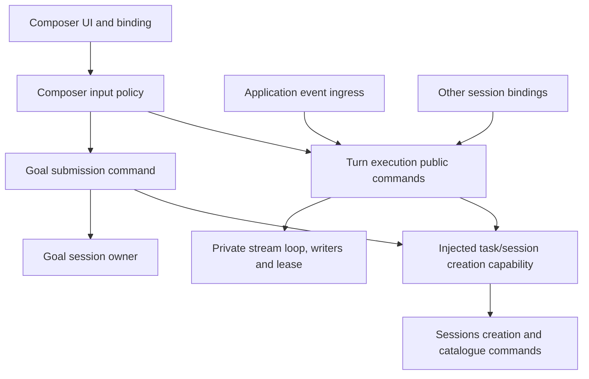
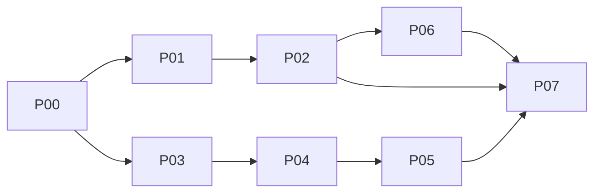

# WebUI business cohesion and execution plan

Status: accepted and under execution on branch `feat/webui-business-cohesion`. The decisions below were
converged through four numbered decision rounds plus a concrete draft audit and a revised-artifact
audit, and the operator accepted the plan; §7.0 records carrier progress.

Design baseline: `5de4b876d0499468153111c91b3a437b4fd143ef`, inspected on 2026-10-15. It is the
comparison point for the source this plan was written against and is **not** advanced by execution;
delivered revisions are recorded in §7.0. Implementation starts from the verified local `webui`
revision `4fce25f2cd870a0f3e1c727c4c89c9937a0fc8f5`, which is ahead of `origin/webui` (`b9a7e207`) by
eleven commits.
Ticket IDs below are local plan identifiers, not GitHub issue numbers or completed work.

## 1. Outcome and scope

Make complete business actions easier to understand, change, and verify while retaining the
correctness mechanisms the application already needs. Success means fewer responsibilities and
ordering obligations exposed to callers, not a particular file size, directory count, or pattern.

This plan covers the retained designs and findings A1–A5 from the architecture review:

| Review item | Executable outcome | Carrier |
| --- | --- | --- |
| Valuable existing designs | Named invariants with separate structural and behavioral evidence | P00, every carrier, P07 |
| A1: conversation responsibility cycles | One application-owned execution module; execution rules no longer implemented by Composer or Sessions | P02 |
| A2: business rules in assembly and Shell | Task/session creation use case, guarded adoption, goal-owned submission, browser-only navigation effects | P01, P02 |
| A3: shallow contracts | OperationSpec-derived unary requests; concrete Provider DTOs and five validated write operations | P03, P04 |
| A4: Provider editing follows parent layout | Models-owned editor and business commands, preserving the Usage page lifetime | P05 |
| A5: browser observation complexity | Executed comparison of client reconciliation and a bounded server observation prototype, with an explicit decision | P06 |

Implementation remains inside the WebUI package except for affected verification declarations,
dependency rules, generated inventories, and architecture documentation. Read the real runtime
contracts to establish compatibility; do not change host business semantics as a shortcut.
P06 may demonstrate that a server design needs a new host contract, but does not implement it.

No state-library replacement, generic event bus, schema/code-generation framework, automatic
runtime method dispatch, wholesale feature merger, or unrelated CSS redesign is planned.
No issue creation, commit, PR, deployment, credential change, or live paid provider call is part
of preparing or reviewing this plan. Those actions follow their own authorized execution scope.

## 2. Source-grounded starting point

The following are current-source findings, not claims that a browser failure was reproduced.

| Evidence | Current responsibility and implication |
| --- | --- |
| [Composer controller](../../packages/webui/src/client/features/composer/application/composer-controller.ts), `submit` and `queueView`; [submission adapter](../../packages/webui/src/client/features/composer/application/composer-submission.ts), `submitWebuiComposerTurnCommand` | Input intent reaches Turn through a forwarding adapter, then returns to injected Composer execution code. |
| [Turn commands](../../packages/webui/src/client/features/turn/application/turn-commands.ts), `sendWebuiTurn`; [Composer workflow](../../packages/webui/src/client/features/composer/application/composer-workflows.ts), `submitWebuiComposerTurn` | Session creation, send/queue branching, stream-loop startup, and UI setters are distributed across the two businesses. |
| [Sessions commands](../../packages/webui/src/client/features/sessions/application/session-commands.ts), stream-phase/lifecycle factories; [collaborator wiring](../../packages/webui/src/client/application/turn-command-wiring.ts) | Turn's execution writers are implemented in Sessions and injected back into Turn. Removing injection alone would expose reverse dependencies rather than transfer ownership. |
| [Application assembly](../../packages/webui/src/client/application/create-application.ts), `turnCommandsFor`; [session binding](../../packages/webui/src/client/bindings/use-session-state.ts), `useWebuiSessionCommands` | Both construct conversation command contexts. A shared algorithm does not eliminate the second construction policy. |
| Application assembly, `createOrPatchGoal`, two home-adoption implementations; [new-task hook](../../packages/webui/src/client/shell/use-new-task-workspace.ts) | Goal decisions and creation completion rules are mixed into assembly and React orchestration. |
| [Wire](../../packages/webui/src/client/platform/wire.ts), `request<T>`; [OperationSpec](../../packages/webui/src/shared/operation-names.ts) | Client callers select a result type independently of the operation, although the server already checks a central request/result map. |
| [Provider panel](../../packages/webui/src/client/features/models/ui/ProviderFormPanel.tsx), `openProviderForm`, `draftCandidate`; [Usage page](../../packages/webui/src/client/features/settings/ui/UsageModelSettings.tsx) | Settings holds individual Provider draft fields; Models UI assembles candidates and interprets business outcomes. |
| [Runtime Provider view](../../packages/local-runtime-v2/src/service/model-system/contracts.ts), `ModelProviderView`; [process-local mapping](../../packages/local-runtime-v2/src/application/session/process-local-application.ts), `toProviderRecord` and `saveCandidate` | Actual list data uses `configRevision` and names-only `headerNames`; the panel reads `revision` and `headers`. Candidate save is mapped from service `ok` to wire `success`. |
| [Turn recovery](../../packages/webui/src/client/features/turn/application/turn-commands.ts), `recheckWebuiSubscription`, `recoverMissedWebuiTurn`; [stream loop](../../packages/webui/src/client/conversation/stream-loop.ts) | Recovery spans both process events and stream resume/history. Reading only the idle probe branch cannot establish a stuck-terminal bug. |

The ordinary Composer path passes `handleSessionCreatedViewEffect`, whereas the plugin chat
creation path calls `handleSessionCreated`. These are different origins; they do not prove two
adoptions for the same send. Consolidate duplicated implementations without claiming that defect.

Missing raw header values are intentional. The fix must construct saved rows from header names
and preserve unchanged values, not expose previously hidden values.

## 3. Invariants that must survive

| ID | Preserve | Required evidence |
| --- | --- | --- |
| I01 | Business-first feature ownership; shared mechanics only where behavior is actually shared | Read the final ownership/import graph and exercise the changed use cases. No five-directory template requirement. |
| I02 | Application-owned runtime owners; dormant construction, one start, terminal disposal | Lifecycle tests for start/remount/dispose, late completion, and exactly one ingress per started application. |
| I03 | One canonical session runtime record map and one session catalogue | Commands and installed ingress observe the same records; no second mutable complete session snapshot repository. |
| I04 | One process-event ingress with permanent owner routes, including unmounted sessions | Inject events without a Composer view, then attach a view and verify committed state and deferred reconciliation. |
| I05 | Separate selected-view/secondary interest, stream delivery, accepted mutation settlement, and host execution | Navigation releases only view interest; delivery detach does not abort host execution; owed settlement finishes or records failure. |
| I06 | Generation-fenced stream writes and resource identity/freshness/incarnation guards | A late stream/probe/query cannot overwrite a newer attempt, credentials/configuration generation, or disposed owner. |
| I07 | Framework-free business logic with browser IO injected at real seams | Application commands run without React/DOM; bindings handle URL/focus/scroll; platform owns socket/storage IO. |
| I08 | Authenticated loopback validation, explicit runtime ports, and meaningful harness result conversion | Separate malformed-body/transport tests and real local runtime tests; preserve auth, envelope and shutdown behavior. |
| I09 | Draft/history/staging/queue lifetimes and honest unsupported outcomes | Preserve existing field transitions and persistence caps; no new secret serialization; absent capabilities do not report success. |

I05 includes service-owned terminal processes and runtime-owned account credentials. This plan
does not transfer either into a browser owner. Existing review/workspace ownership and feature
styles remain in place unless a listed integration requires a specific change.

## 4. Decisions and rejected alternatives

These decisions replace only the conflicting ownership/interface prescriptions in earlier
WebUI plans. Existing completion evidence remains historical evidence; it does not prove these
new outcomes. Record the implemented decisions in a new ADR during P07 rather than rewriting
accepted ADR history or reopening the old T01–T21 program by implication.

| Decision | Selected | Rejected and reason |
| --- | --- | --- |
| Execution ownership | Transfer execution implementation into existing `features/turn`; retain pure loop/lease mechanisms in `conversation` | Move shared policy into a generic directory merely to permit Turn to call Composer/Sessions internals: fixes the import shape while retaining responsibility round trips. |
| Public command shape | Intent plus semantic decision and terminal completion; internal writers/sinks/factories stay private | Rename setters or inject the same peer implementation bundle: callers still need the execution protocol. |
| Creation/adoption | Named application use case with independent home incarnation and navigation epoch | Use current `selectedSessionId === undefined` or a stream lease generation: neither identifies a pending creation before stream IO. |
| Adoption collision | Existing destination runtime record wins; guarded source transfer only when destination is absent | Blind overwrite or generic deep merge: either can erase a newer event or mistake an authoritative clear for a default value. |
| Client typing | Derive unary request/response from existing OperationSpec, then strengthen the concrete Provider slice | Add another parallel client contract map or derive browser contracts from private runtime implementation. |
| Provider editor | Models owns editing semantics; instance lifetime is a Usage page visit above its source-tab conditional | Global/dialog-wide singleton extends current draft/secret lifetime; keeping field setters in Settings preserves parent-layout coupling. |
| Inspection | Keep current two-second Composer inspection scheduling and its view attachment boundary | Treat the presence of an owner-held timer as a defect and rewrite unrelated polling without evidence. |
| Observation architecture | Mandatory two-arm experiment with end-to-end correctness and total cost criteria | Automatic server promotion or adding a sequence to live events and calling it a consistent snapshot. |

## 5. Target ownership and interfaces

### 5.1 Execution without business round trips



`features/turn/application/conversation-execution.ts` is the proposed single execution owner.
Its public types live in the existing Turn contracts home. It owns send/enqueue admission,
attach/recheck/recover, stop, and explicit `resumeObservation` behavior. It creates execution
writers and stream sinks internally and reads authoritative current execution state itself.

Move stream-phase/lifecycle implementations and their corresponding contracts out of Sessions.
Keep interaction-specific commands with their actual owner; do not move the entire mixed
`session-commands.ts` file as one responsibility. Move send/enqueue execution out of
`composer-workflows.ts`; move its goal submission behavior to Goal, retaining input policy in
Composer. Transfer the enqueue capability type out of Composer if execution owns its contract.

Composer retains slash/goal/plan intent interpretation, draft/history, attachment staging,
queue presentation, and resend eligibility. `resendRecordedInput` uses ordinary submission;
`resumeObservation` resumes observation from a cursor. They are not interchangeable retries.
The queue mirror keeps its existing selection/generation fence and is not silently converted
into a persistent per-session queue cache.

Bindings read the execution owner from the application. They do not construct another command
context or production owner. Tests and SSR use the same explicit fixture assembly with declared
capabilities; do not add a hidden fallback execution owner to preserve a fixture shortcut.
Stateless identity-bound facades may be returned without an unbounded per-session command map.

The execution intent carries target identity, content, attachments, and supported client intent.
It does not carry `sending`, store writers, sink factories, or UI setter callbacks. The injected
creation capability resolves a target and performs its use case; it is not a bag of peer factories.

### 5.2 Admission, decision, and terminal completion

The public submission shape is conceptually:

```ts
submit(input: SubmissionIntent): SubmissionOperation;

interface SubmissionOperation {
  readonly id: string;
  readonly decision: Promise<SubmissionDecision>;
  readonly completion: Promise<ExecutionOutcome>;
}
```

Use discriminated outcome types, not optional bags that permit impossible combinations.
`decision` distinguishes `dispatching`, `queued`, `needs-session`, `creation-failed`, `busy`,
`unsupported`, and `failed`. A dispatched/queued decision carries the concrete destination.
`completion` is a non-rejecting terminal result: completed, failed/refused, superseded,
detached, disposed, or not-started as appropriate to the actual path. A detached observer is
not evidence that host execution completed. Both promises settle once, and their outcomes must
agree with the originating attempt's recorded state; use a generation-scoped record, not the
session's possibly newer current attempt, when checking that agreement.

| Milestone | Meaning | Composer effect |
| --- | --- | --- |
| `dispatching` | Local generation claimed and stream dispatch beginning; no new server acknowledgement is implied | Clear only the captured input/staging revision, at the existing send-start boundary. |
| `queued` | Enqueue request returned success | Clear only the submitted input/staging and refresh the still-current queue destination. |
| `needs-session`, `creation-failed`, `busy`, `unsupported`, pre-dispatch `failed` | No message dispatched by this attempt | Preserve draft/staging and expose the actionable outcome. |
| Post-dispatch refusal/transport failure | Execution or observation failed after local dispatch | Record failure on the originating attempt; retain the existing cleared-input behavior and resend affordance. |

If preserving the synchronous pre-socket clearing order requires notification, use one named
submission-transition subscription installed by application composition before commands run.
It publishes semantic facts with attempt/origin/revision identity. Composer performs its own
field transition; execution receives no per-call setters. Do not introduce a general event bus.
The decision and transition describe the same milestone, not two independent acceptance states.

Serialize admission only through reservation and dispatch/enqueue classification, not until a
whole stream ends. Otherwise a second message cannot reach the queue while a turn is running.
Delivery handles and settlement leases remain owned until the actual attempt finalizer; an
early `decision` resolution must never execute the old outer `.finally(hold.release)` cleanup.
All attach/resume/send paths track and close their own delivery handle on application disposal.
No ambiguous transport failure triggers an automatic message resend or a second create request.

### 5.3 Task/session creation and navigation

`client/application/task-session-workflows.ts` is a named cross-business use case, not another
generic service layer. It owns task workspace/no-project policy, creation completion and home
incarnation/navigation metadata. It delegates catalogue storage to Sessions, Composer fields
to Composer commands, runtime records to the canonical store, and goal decisions to Goal.
Platform storage is injected; Shell retains picker visibility, URL and other DOM effects.

Before creation IO, synchronously capture an attempt ID, home incarnation, navigation epoch,
requested workspace/team-mode/agent context, and input/staging revision. The use case keeps
only this operation metadata and immutable submitted inputs, not a second mutable session map.

Rules:

1. One creation may be pending for a home incarnation. A second submit returns `busy` before
   wire IO, preserving input. It is not an implicit deferred FIFO and does not create a second session.
2. Explicit New Task advances home incarnation even if selection remains `undefined`.
   Actual navigation advances navigation epoch; duplicate route/binding notifications do not.
   Returning home after visiting another session does not recreate the old navigation claim.
3. Successful creation always settles into its concrete session, records the request's captured
   team-mode choice, and invalidates/refreshes the supported catalogue reads. Catalogue read
   failure is recorded and retryable; it does not undo a created session or trigger creation again.
4. Transfer the source home record only when its incarnation still matches. If destination is
   absent, transfer; if present, preserve its whole runtime record; if purged, refuse resurrection.
   The store returns an explicit transfer result such as `transferred`, `target-exists`, `purged`,
   or `stale-source`; no silent no-op may leave a submission unsettled.
5. If the home incarnation changed, continue the original submission on the created destination
   from immutable input and fresh state, preserving any existing destination record. Never migrate
   the new home record, clear its new draft/staging, or maintain detached whole-home copies.
6. Composer slot adoption is separately version-guarded. Preserve a newer destination draft;
   retain the existing history order, pruning and byte caps. Clear/move source fields only when
   they still belong to the captured revision, so typing during creation is not lost.
7. Select the created destination only if the originating navigation claim is still current.
   Publish ordinary adoption as one coherent application notification, not intermediate identities.
   A late background completion still publishes its legitimate state, without changing selection.
8. Browser navigation consumes the committed result and checks its selection version again.
   A user navigation between business commit and URL effect wins. Creation completion and
   catalogue/team-mode updates must work without a mounted Composer or Shell callback.

Goal submission moves to `features/goal/application/goal-submission.ts`, using this target
resolution capability and the target session's Goal owner. Remove `usesPatch`/create-or-patch
business decisions from `create-application.ts`. Preserve ordinary goal mode, patch/create,
error, and home submission behavior except the explicit concurrency deltas below.
Plugin chat creation and normal Composer/Goal creation use the same completion policy.
Workspace selection precedence, no-project persistence, and explicit project New Task behavior
remain the same, now owned by the use case rather than React effects.

### 5.4 Typed unary operations and Provider data

Derive client unary request and response types from `OperationSpec[Name]`. Callers cannot choose
an unrelated result generic. Exclude `sendMessage`, `resumeSession`, `watchEvents`, and
`watchTerminal` from the unary name set using shared compile-time operation-kind metadata;
stream handlers keep their dedicated lifecycle. Do not import server descriptors into the browser.
Verify shared operation-kind metadata against the registered server stream descriptors in Node
tests, so a newly added stream cannot silently remain callable through the unary interface.
Resolve any discovered transport/spec disagreement through its real producer/consumer mapping,
not casts, `any`, or weakening the central spec. Existing empty request bodies remain valid.

Add WebUI-owned DTOs to `shared/contracts/models.ts`, based on the real process-local surface:

- Provider read: stable fields actually consumed, including `providerId`, `name`, source/kind,
  enabled state, optional base URL/API format, credential-presence/masked fields, names-only
  `headerNames`, optional `configRevision`, model entries, and relevant status fields.
- Presets, discovery results, model inputs, candidate input, connection-test outcome, and save
  outcome: model the actual supplied shapes. Candidate save uses wire `success`; connection
  test normalization follows its actual producer, not a guessed common success flag.
- Keep supported model extensions and free-form `apiFormat`. Explicit request extension data
  may remain open where runtime supports it; known read DTOs must not have an index signature
  that makes `provider.revision` or `provider.headers` silently typecheck.

Use these DTOs directly through client port/workflow/editor and server/runtime adapters. Do not
introduce an equivalent client view alias solely to preserve another contract directory.
Runtime-owned types do not cross into the browser; the harness adapter checks/projects them
at the real seam. Unrelated genuinely unknown results stay honest and use defensive readers.

Strengthen ingress validation for exactly:

| Operation | Known shape to validate |
| --- | --- |
| `createUserModelProvider` | Required base URL/API key; optional name/format/headers/models/save-and-use and supported extensions |
| `updateUserModelProvider` | Provider ID and supplied patch fields, including model toggles/reorder and header changes |
| `discoverUserModelsCandidate` | Base URL and the existing saved-provider revision branch or new-provider credentials/format branch |
| `saveUserModelProviderCandidate` | Nested candidate plus outer model ID/save-and-use/skip-connection-test fields |
| `testUserModelCandidate` | Nested candidate and required model ID |

Validate known optional fields when supplied, nested model/header/remove-header structures,
and branch requirements against the runtime contract. Preserve supported extensions rather
than reconstructing a lossy whitelist. Leave the existing narrow delete/test-provider/test-model/
key-upsert/key-reveal validators within their current scope. OAuth, terminal, plugin management,
permission, event and all other operations retain their current validation behavior.

Changing malformed Provider requests from runtime errors to `invalidBody` is intentional.
In particular, [candidate wire compatibility](../../packages/webui/test/unit/webui-candidate-wire-compatibility.test.ts)
currently contains only malformed-input forwarding/byte-equivalence coverage. All five existing
input cases become ingress failures under the new contract: assert `invalidBody` and no runtime
call, replacing their old byte-equivalence and runtime-call expectations in full. Add a separate
valid candidate/model-ID case, including supported extensions, that proves actual forwarding
and the response envelope. Preserve unrelated compatibility coverage elsewhere. Do not retain
the old malformed byte-equivalence assertion by weakening the new validator or test.

### 5.5 Models-owned editor, existing lifetime

Add `features/models/application/provider-editor.ts` and its Models binding/public types as
needed. Models defines the editor policy; the binding owns one instance for a Usage page visit,
above the `sourceTab === "custom"` conditional. Binding construction remains dormant; IO runs
through explicit open/test/save commands, never render-time construction.

The editor owns the editing identity, draft, candidate construction, test validity, pending
operation/error state and command outcomes. It calls the existing Models workflow for catalogue
mutations and invalidation; it does not independently write keyed catalogue/provider/preset caches.
Use typed `openNew`, `openExisting`, `changeField`, header/model edits, `test`, `discover`, `save`,
`delete`, and `close/reset` intents. A field edit invalidates an earlier test when its candidate
meaning changes; a late test result for an older draft cannot validate the current one.

Settings passes/hosts the editor capability rather than individual field setters. UI retains
menu open/query, focus, expansion, and display mechanics. Preserve Provider form/picker reset
behavior when the custom source tab unmounts; the editor binding explicitly ends that form view,
resets transient operation feedback, and fences late view writes while retaining the draft.

Usage source-tab changes preserve drafts. Leaving the Usage category or closing Settings
disposes the editor, clears credential-bearing fields, and fences late reveal/test/discovery
completions. A mutation already sent still settles and invalidates the application-owned catalogue;
it must not repopulate a disposed editor. Keep reveal-on-open behavior and its current permission
semantics; do not add credential persistence or new credential operations.

Initialize saved header rows from `headerNames` with blank values and persisted names. An
unchanged named blank row means retain its saved value. Replacement supplies a value; rename
or removal uses the existing explicit removal semantics. Preserve duplicates/missing-value
validation. Do not fetch or display raw saved header values to make the editor convenient.
Keep quota clocks, OAuth behavior, preloads and unrelated Settings controls unchanged.

## 6. Explicit behavior deltas

The following require their own before/after scenario. Everything else is a preservation target.

| ID | Intended change | Distinguishing acceptance |
| --- | --- | --- |
| D01 | Execution reads live state and reserves admission; same-home creation is single-flight | Two submissions before creation returns issue one create; the second is `busy` with untouched input. A second submission during a known active turn queues without waiting for stream completion. |
| D02 | Late home creation respects incarnation, navigation and draft versions; captured request choices win | home→B→home, explicit New Task, changed draft, and changed team-mode default during IO do not steal navigation or modify the new home; created session records its submitted choice. |
| D03 | Existing/purged destination is protected during adoption | Destination event/second-client state survives; purged destination is not resurrected and the attempt terminates. |
| D04 | Provider consumes actual `configRevision`/`headerNames` | A real-shape existing Provider supports discovery with expected revision and editable names-only header rows. No secret values are exposed. |
| D05 | Five malformed Provider write bodies fail at ingress | Exact `invalidBody` outcome, no runtime invocation, valid bodies/extensions unchanged; update the named compatibility test deliberately. |

Internal command naming and typed request inference do not authorize a wire rename or new
operation. Earlier result availability is an internal contract change: preserve the visible
send/queue clearing boundaries through named transitions and keep terminal cleanup separate.

## 7. Implementation carriers and dependencies

All carriers start as NOT STARTED. Their exit criteria are future execution requirements.
One carrier may need several reviewable commits; every committed intermediate state must have
one effective owner, a coherent import graph, and the applicable checks passing.

### 7.0 Programme position

| Carrier | Status | Revision | Evidence |
| --- | --- | --- | --- |
| P00 | done | (work material, not a source change) | baseline gate run, caller/import map, field/lifetime matrix, broad-contract inventory, before-change scenario ledger — all under `~/my_data/project/my_project/minimax-code-webui-work/business-cohesion-20261015/p00/` |
| P01 | in progress (step 3: workspace policy moved out of Shell; the create/adopt cutover is step 4-5 with P02) — slice 1 landed (creation use case + store guards, no production switch) | (this commit) | `test/unit/task-session-workflows.test.ts`; report under `…/business-cohesion-20261015/p01/slice-1-evidence.md` |
| P02 | in progress (step 9 + the admission half of step 2: the decision vocabulary and the rule are in place and unit-tested; the execution owner, the caller migration and the cutover remain) | | |
| P03 | done | (this commit) | `test/unit/webui-unary-operation-typing.test.ts`; report under `…/business-cohesion-20261015/p03/evidence.md` |
| P04 | done — D04 and D05 landed | (this commit) | `test/unit/model-provider-projection.test.ts`, `test/unit/webui-candidate-wire-compatibility.test.ts`; reports under `…/business-cohesion-20261015/p04/` and `…/p04b/` |
| P05 | **done** — the editor is the Models policy, the Usage screen hosts one instance per visit above its custom-tab branch, and the provider form renders that editor's snapshot | `b1c2366c`, `8d2ed010`, `c4220980` | `test/unit/provider-editor.test.ts` (15), `test/unit/provider-form-panel.test.ts` (rewritten for the new home), `test/webui-browser/provider-form.spec.mjs` (4, whole browser suite 124 green); reports under `…/business-cohesion-20261015/p05/` |
| P06 | not started | | |
| P07 | not started | | |



P01 and P02 form one coordinated production cutover when their effects cannot safely ship
separately. In particular, legacy Composer code resets the stream after creation; installing
destination-wins adoption alone would not protect a destination that the old send path then
resets. Build/test P01's use case first, but deliver ordinary-send integration together with P02's
live admission and target guards. Do not declare P01's end-to-end exit satisfied by testing only
the adoption helper, or publish a half-integrated production path between these carriers.

### P00 — Establish behavior and contract evidence

Depends on: none. Covers all retained designs and A1–A5 baseline uncertainty.

Outputs:

1. Revalidated SHA/worktree, current execution/caller/import map, and a field/lifetime matrix.
2. Reusable synthetic application fixture using the production assembly and installed ingress.
3. A before-change scenario ledger identifying preservation cases, D01–D05, and unverified claims.
4. A reproducible inventory of broad request/result sites. State the executable classification;
   `Record<string, never>` is a valid empty body, not a broad data contract. Counts are descriptive.

Inspect/extend `test/support/application-fixture.ts`, `webui-application-commands.test.ts`,
`home-adoption-transaction.test.ts`, lifecycle/freshness/scope tests and current browser fixtures.
Register new Vitest files in `test/vitest-suites.json` and include type assertions in a compiled
test program. Write reports and temporary synthetic state outside the repository.

Exit: run the relevant current gates and preservation cases; record failures and environment
limits. A behavior delta needs a baseline-failing case. A preservation case may correctly pass
both revisions; prove the new implementation owns it with a targeted fault/mutation or old-path
removal check, not by requiring every preservation case to fail on the baseline.

### P01 — Own task creation, identity, and completion

Depends on P00. Covers A2 and D02–D03; establishes the creation reservation needed by D01.

Targets: new `application/task-session-workflows.ts`, canonical `session-store.ts`, Composer
versioned adoption methods, `shell/use-new-task-workspace.ts`, `WebuiClientFoundationApp.tsx`,
Sessions team-mode/workspace policy and workflows, new Goal submission module, and assembly.

Steps:

1. Implement the independent creation/home/navigation metadata and explicit transfer result.
2. Implement destination-wins/purge guards and versioned Composer adoption as one use case.
3. Move workspace/no-project and creation completion rules out of Shell; expose named commands.
4. Route ordinary send target resolution, Goal submission, and plugin chat creation through it.
5. Move goal create/patch/target-owner decisions out of assembly. Remove both inline adoption
   implementations in favor of the single use case. Shell consumes committed navigation effects.

Exit: ordinary first-send/goal adoption remains coherent; D02–D03 pass; all creation origins work
without a mounted callback. Include existing destination goal/permissions/transcript clears,
creation response failure, successful creation followed by send refusal, catalogue refresh error,
late callback after dispose, and home→B→home/new-home races. Preserve no-project/project defaults.

### P02 — Transfer complete execution ownership and integrate every caller

Depends on P01 and P00. Covers A1, A2 integration, and D01.

Targets: new Turn execution owner/public contract; Turn commands/coordinator/queue modules;
Sessions stream-phase/lifecycle/writer portions and contracts; Composer workflow/controller/
submission adapter; interaction owner integration; application assembly and session bindings.

Required callers: Composer submit/resend, Sessions/session commands, Interactions phase changes,
event ingress attach/recheck/recover, shell observation retry, Goal-triggered execution observation,
and `useWebuiSessionCommands`. Inventory actual imports/callers before retiring old declarations.
Migrate their fixture assemblies in the same batch, including `test/support/application-fixture.ts`,
`webui-service.test.ts` scripted ports and `webui-host-shape-invariant.test.ts`; fixtures must not
reintroduce a private owner or bypass the production capability contract.

Steps:

1. Transfer implementations and contracts; retain loop/lease algorithms rather than reimplementing.
2. Add decision/completion/transition contracts and per-target admission. Bind creation reservation.
3. Replace app and binding construction with the one application owner. Publish narrow interaction
   phase intents without exposing a generic writer or creating another private peer import.
4. Let Composer consume semantic transitions using captured field revisions and queue destination.
5. Retire `WebuiTurnCommandCollaborators`, `turn-command-port.ts`, `turn-command-wiring.ts`,
   forwarding-only submission functions, and old execution branches after all callers migrate.
   Keep unrelated declarations in mixed files; file deletion is not the goal.

Exit: no Turn→Composer/Sessions application implementation dependency for execution; no second
binding command assembly; direct and view-triggered commands share the same owner. Test
running-turn enqueue, home single-flight, enqueue failure, attachments-only sends, absent
capabilities, resume versus resend, late refusal, selection changes, stop, detached observer,
old stream/probe answers, and terminal cleanup. All delivery paths must register their handles.

Shrink measured obsolete entries in `scripts/lib/webui-peer-imports.json` in the same commit;
update ownership rules only to reflect the new responsibility. Do not disable cycle/role checks.
Update command discovery, tripwires and generated command/navigation output after behavioral
coverage exists; review file additions/removals and regenerate public source inventory per commit.

### P03 — Derive unary requests from OperationSpec

Depends on P00. Covers A3 without changing wire behavior.

Targets: `shared/operation-names.ts`, `client/platform/wire.ts`, `client/platform/transport.ts`,
and compiled type-contract/transport tests.

Steps: declare the shared unary/stream distinction, replace caller-selected `request<T>`, migrate
every existing unary call, and resolve type mismatches through actual producers. Retain explicit
business-method mappings, timeout/envelope/request ID/socket cleanup, and dedicated streams.

Exit: positive calls compile; wrong operation/body/result assumptions and a stream passed to
unary request fail at the actual reader. Execute transport tests for success/error/timeout/close.
Inspect all call sites to prove there is no generic/string escape hatch outside the wire decoder.

### P04 — Type the real Provider seam and validate its write inputs

Depends on P03. Covers A3, D04 contract alignment and D05.

Targets: `shared/contracts/models.ts`, OperationSpec, Models port/workflow, runtime port and
harness host/Models adapter, `server/operation/provider.ts`, typed bindings, and affected UI reads.

Steps: declare the actual shared DTOs; map/check the real process-local results; replace broad
known Provider reads; implement exactly the five validators in section 5.4; change consumers to
`configRevision`/`headerNames` and actual save/test outcomes. Preserve supported patch/model
extensions, request branching, free API format, and omitted versus blank credential behavior.
In the candidate compatibility test, replace the entire malformed-input runtime-call expectation
and add a new positive forwarding case; that file has no existing positive case to preserve.

Exit: compiled consumer assertions reject the old misspelled fields; real-shape fixtures cross
adapter→loopback→transport; D04–D05 pass. Include positive discovery create/edit branches,
revision conflict, same-name blank header retention, replacement/removal, model reorder/toggle,
save-and-use/skip-test, connection-test refusal and malformed nested fields. No casts may replace
the proof of the producer→wire→reader relationship. Existing unrelated validation stays unchanged.

### P05 — Encapsulate Provider editing in Models

Depends on P04. Covers A4 and the editor portion of D04.

Targets: new Models editor/application/binding contracts, `ProviderFormPanel.tsx`,
`UsageModelSettings.tsx`, existing Models workflow and header projection, related browser tests.

Steps: move candidate/test/save/discovery/edit identity and pending/error semantics into the editor;
replace Settings field/setter plumbing; preserve the source-tab form reset/draft retention split;
add operation/draft-generation fences and disposal; leave catalogue invalidation with Models.

Exit: opening/editing/testing/saving/deleting works from the editor interface without React;
adding an editor field does not require parent Settings state/setters. Verify source-tab retention,
category/dialog reset, late reveal/discovery/test/save, changed candidate after a successful test,
header semantics, failed mutation, and catalogue update after editor disposal. Browser evidence
must show the real-shape discovery control/header rows and existing form interactions. Compare
rendered screenshots if markup/layout changes; a CSS source hash is not visual acceptance.

### P06 — Execute the A5 observation comparison

Depends on P02 and P00. P03/P04 are independent unless a selected fixture uses the Provider seam.

Outputs: reproducible experiment runner and synthetic inputs, executed trace/cost results, and
`docs/webui/DECISION-webui-observation.md` with a keep-client/promote/inconclusive outcome.
The decision document is a future output, not a claim of an experiment already performed.

Use both the process-event and stream-delivery channels in each arm:

- Arm A: existing protocol with an explicit client reconciliation policy using active-turn/history
  reads and generation fencing. Establish baseline behavior first; test a proposed repair only
  when a trace demonstrates the missing transition. Do not assume idle means a terminal event
  was lost or release a newer local attempt on a stale probe.
- Arm B: server snapshot plus bounded deltas prototype, with authenticated ownership, independent
  server epoch, cursor, explicit gap/overflow/restart behavior and teardown. Subscribe to upstream
  before snapshot and buffer during construction, but prove authoritative ordering/snapshot
  consistency separately. The live-only event bus and message cursor supply neither guarantee.

Do not add a production operation, alter the public event stream, enable a feature flag, or
add a host API. Keep scratch prototype code outside the repository. If reusable synthetic test
support is retained, review and register it as test source/inventory; it is not hidden scratch.
Register executable Vitest support through its declared suite in `test/vitest-suites.json` and
review all retained files in `release/public-source.json`; untracked worktree files are scanned too.
If the existing host cannot support a correct prototype, demonstrate the failed consistency
obligation using executable counterexamples and report no-go instead of inventing a stronger host.

Run the same deterministic traces against both arms and an always-online oracle:

| Trace | Required observation |
| --- | --- |
| Missing start event | Observe another client's turn without duplicating a local send. |
| Missing terminal event, independently dropped on each channel and both | Correct final busy/phase/transcript state, or an explicit demonstrated limit. |
| New local send while active-turn/history reads are pending | Old probe/history cannot settle, retarget or overwrite the new attempt. |
| Reconnect during snapshot; events between subscription and snapshot | No missing/duplicated logical update; demonstrate ordering rather than infer it from acknowledgement. |
| Restart or resume-buffer overflow | Explicit resnapshot/gap behavior with no stale-epoch commit and bounded retained state. |
| Second client executes while this client changes selection or creates a home session | Background target state survives adoption and later view attachment. |
| Stop, dispose, rapid reconnect and stale completions | Delivery cleanup, correct settlement and no host abort from observer detach. |

Inject frame loss at the existing socket seams and scripted runtime seam. Use settled barriers
and recorded operations rather than sleeps as evidence. Compare phase, sending, subscription
identity/generation, transcript tail/message IDs and relevant pending/goal state before loss,
at reconnect, and after convergence. Include a real local-runtime synthetic integration case;
a scripted host is sufficient for deterministic fault injection, not for host consistency claims.

Measure per-trace request/round-trip counts, retained client/server data and buffers, recovery
branches and ownership obligations, new protocol/persistence identities, and cleanup behavior.
Use comparable inputs and define measurement units; do not claim performance improvement from
source-line deletion or synthetic request counts alone.

Decision rules:

1. Correctness against the oracle and a justified consistency model are prerequisites for promotion.
2. Keep the client approach if it meets the scenarios with fewer total responsibilities or the
   server approach cannot prove ordering without a new host contract. An identified client defect
   gets a bounded, separately specified remediation; it does not justify a server rewrite by itself.
3. Recommend promotion only if Arm B passes all scenarios, removes identified browser recovery
   knowledge, and demonstrates a material total-system benefit that justifies its new obligations.
   List the eliminated client policies and retained server obligations explicitly.
4. An inconclusive result names exactly one bounded evidence-gathering follow-up and its stopping
   condition. After that, absent proof, do not promote. Keep A5 unresolved in implementation status
   until that follow-up has run; never relabel missing evidence as keep-client success.
5. Promotion is an architectural recommendation and a concrete follow-up proposal for review,
   not production implementation or automatic protocol rollout under this plan.

Exit: the runner/counterexamples have actually executed, the trace and total-cost evidence is
available, and the durable decision covers both arms or demonstrates why the server arm cannot
meet its consistency obligation. Complete any single bounded inconclusive follow-up before closing
P06. Source reading, a reproduction recipe, or this plan alone cannot satisfy that exit.

### P07 — Integrate, retire old paths, and publish the effective contract

Depends on P01–P06, including a completed P06 decision/follow-up. Covers all invariants.

Steps:

1. Trace the final assembled flows and remove obsolete production execution/adoption/editor paths.
   Check every P02 caller and ensure public commands and installed ingress use one effective owner.
2. Update `CONTEXT.md`, a new ADR, package guidance, relevant plan cross-references and generated
   navigation/command surfaces to describe implemented ownership. Preserve old evidence and clearly
   distinguish the new program from completed historical programs. Do not overwrite pending work.
3. Review measured dependency exceptions, test-suite declarations and publication inventory;
   regenerate applicable files using their tools. No private logs, sessions or real user content.
4. Run the validation matrix below and close each ticket with direct evidence and remaining limits.

Exit: no open design decisions for A1–A4, every D01–D05 scenario passes through its proper seam,
retained invariants have direct evidence, A5 has its executed decision, and no obsolete path or
generated declaration contradicts the new owners. Implementation remains incomplete when any
required gate is failing/blocked; report the missing evidence rather than weakening completion.

## 8. Verification and evidence boundaries

| Evidence tier | What it proves | Existing starting points |
| --- | --- | --- |
| Compiled contracts and resolved imports | Request/result relation, producer mapping, intended dependency direction | `typecheck:webui`, `typecheck:webui-full`, host contract/type tests, dependency gate |
| Assembled application + installed ingress | Command, state, identity, adoption, event, disposal and settlement behavior | Application commands/lifecycle, home adoption, event coordinator, scope/freshness/stream tests |
| Socket/loopback with synthetic runtime | Encoding, malformed-body outcome, envelope, auth and actual dispatch | `webui-transport-wire`, operation binding/service/candidate compatibility tests |
| Real local runtime with synthetic data/model server | Actual harness/host mapping and end-to-end local behavior | `test/integration/real-host-loopback.test.ts`, `real-host-model-turn.test.ts` |
| Built browser interaction and rendered images | Mounted lifecycle, navigation, controls, DOM state and visual preservation | `test/webui-browser/composer.spec.mjs`, `turn-lifecycle.spec.mjs`, relevant Settings/Models specs |
| Live external provider / other OS / hosted performance | Only the explicitly exercised external or platform behavior | Separate acceptance; never inferred from the previous tiers |

Keep baseline failures separate from regressions, but do not call a required failed gate passing.
For D01–D05, demonstrate the baseline distinction and the fixed result. For responsibility moves,
behavioral preservation plus new-path/old-path inspection and a targeted fault demonstrate transfer;
AST/pure-move evidence alone does not. Avoid source-text tests that merely restate implementation.

During each affected carrier, run the relevant focused declared tests, then:

```sh
pnpm typecheck:webui
pnpm typecheck:webui-full
pnpm test:webui
pnpm check:webui-dependency
pnpm build:webui
pnpm check:webui-boundary
pnpm check:webui-commands
pnpm check:webui-business-navigation
pnpm check:source
git diff --check
```

Regenerate commands/navigation only after changing their sources, using
`pnpm gen:webui-commands` and `pnpm gen:webui-business-navigation`. Review additions/removals
before `node scripts/source-inventory.mjs --write`; include its generated result with the carrier.
New Vitest files belong in the declared suite. Keep every intermediate carrier's inventory and
dependency approvals coherent rather than postponing fixes until P07.

Run `pnpm test:webui-browser` for changed mounted behavior on supported Linux with a current
build. Direct `pnpm exec playwright test ...` is suitable for focused iteration when the browser
is already installed. Use task-specific external `TMPDIR`, `WEBUI_BROWSER_OUTPUT_DIR` and
`MCODE_VERIFY_REPORT_DIR`; keep generated state/reports outside the repository and system temp.
Review the actual rendered screenshot when claiming layout preservation. CSS snapshots, where
available, are supplementary rather than a replacement for the rendered result.

Before a later PR, run the full applicable `pnpm verify` on the reviewed commit with a clean
tracked worktree; its source export reads committed HEAD. A new inventory entry is a release
change and does not qualify for the docs-only profile. Use `pnpm verify --list` for current gates.
Follow the repository's `perf:full`/hosted performance requirements for the large execution
refactor, and report unrun live-service/cross-platform boundaries. Plan preparation does not
authorize publishing a PR or consuming a paid service to obtain that evidence.

## 9. Review and completion checklist

Human review of this document precedes implementation. Review the ownership decisions, D01–D05,
Provider malformed-input compatibility change, and A5's experiment-versus-production boundary.
Intermediate design questions are resolved above; implementation-specific discoveries must be
recorded with their evidence, not silently substituted for a narrower goal.

- [ ] P00: baseline and test seams established; broad-contract inventory reproducible.
- [ ] P01: task creation/adoption/goal ownership and collision semantics implemented and verified.
- [ ] P02: complete execution owner, all callers migrated, peer factory cycle retired.
- [ ] P03: all unary calls derive types from OperationSpec with compiled negative evidence.
- [ ] P04: actual Provider DTOs and the five validators integrated through the real seam.
- [ ] P05: Models editor replaces parent field plumbing with preserved/reset lifetimes verified.
- [ ] P06: both observation approaches evaluated, or executable consistency no-go established;
  decision and any bounded follow-up completed, with no production rollout implied.
- [ ] P07: obsolete paths retired, effective docs/generated declarations current, required gates pass.
- [ ] I01–I09 and D01–D05 have evidence at the appropriate tier; limits are explicit.

This document is the proposed executable plan. None of these unchecked items is an implementation
or experiment result from the planning session.
