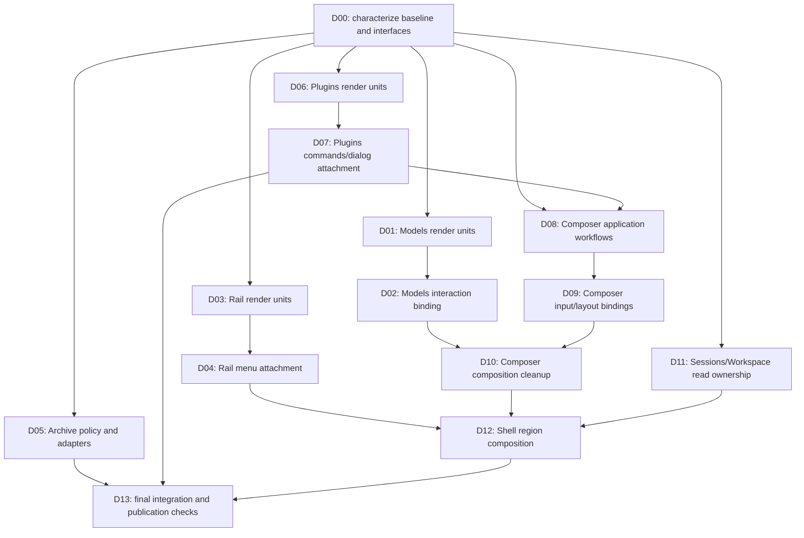

# WebUI large-file responsibility decomposition plan

## 1. Status, scope and authority

- Status: development plan; implementation has not started.
- Revision: 1, 2026-10-14.
- Source baseline: `a12f479add90618c333f824ad3ce033732e364b2`.
- Requested outcome: decompose WebUI source files exceeding 800 lines into coherent responsibilities, preserving current architecture, supported capabilities and observable behavior. Improve locality and ownership rather than satisfying a numerical file-size limit.
- This document authorizes no publication, merge, credential change or production operation. The current request delivers this plan; implementation is a subsequent activity.
- Implementation authority: [architecture Plan](../../../docs/webui/PLAN-webui-architecture-review.md), especially §§4–6; [architecture Spec](../../../docs/webui/SPEC-webui-architecture-redesign.md); [ADR 0016](../../../docs/adr/0016-webui-business-first-modules-and-application-owned-lifetimes.md); [ADR 0017](../../../docs/adr/0017-webui-fences-resource-results-and-separates-delivery-from-execution.md); root and [package AGENTS.md](../AGENTS.md).
- Existing architecture tickets remain historical/program context. This plan does not change their state or replay completed work. Its task IDs are local development units, not new GitHub issues.

Input fingerprints (SHA-256):

| Input | Fingerprint |
| --- | --- |
| `docs/webui/PLAN-webui-architecture-review.md` | `c56b75a5305e4d38c7388956923b6a98b702ca6a2c5895a707cfdde9b7fcc465` |
| `docs/webui/SPEC-webui-architecture-redesign.md` | `55647d8e732764e1d25a858fa6ed2079039c71eca20877012930df3cd2d9129d` |
| `packages/webui/AGENTS.md` | `b070f8c17bc619c7ab043509be3249e292c42ecb74a31abd55738e2d2ece69ff` |

Before implementation, compare these inputs and the named source files with the execution checkout. Content drift requires a task-specific reconciliation record; architecture drift requires revising this plan before dependent work. Historical line references locate baseline evidence, not future edit ranges.

## 2. Baseline census and existing decomposition

Count physical lines in `.ts`, `.tsx`, `.js`, `.jsx`, `.mjs` and `.cjs` files under `packages/webui`. Exclude dependency/build output, documentation, test directories and `.test.*`/`.spec.*` files. Styles and screenshots are outside the census. Include browser, server, runtime and shared source; do not equate the package with browser UI alone.

Paths in development tables are relative to `packages/webui/src/`, unless explicitly prefixed with a repository-root directory.

| Candidate | Lines | Remaining responsibility mixture | Baseline evidence |
| --- | ---: | --- | --- |
| `client/features/composer/ui/WebuiComposer.tsx` | 1,971 | Submission/retry/queue settlement; inspection and selected-resource reconciliation; input/menus/caret; layout effects; composition | Inspection starts around 562; queue mutation around 899; submit/retry around 1303 |
| `runtime/workspace-archive.ts` | 1,194 | ZIP/TAR adaptation, path/expansion safety, listing and extraction workflows | Public operations at 283/327; filesystem policy at 388; ZIP at 574; TAR at 757; listing at 1055 |
| `client/components/shell/WebuiClientFoundationApp.tsx` | 1,185 | Business subscriptions/loading, project answer copy, selected-session derivation, agent reader override, rail/conversation markup | Project read at 266; progress at 438; reader override at 477; presentation from approximately 810 |
| `client/features/models/ui/ModelPicker.tsx` | 1,027 | Menu list, search/keyboard cluster, draft editor, cascade/hover/DOM attachment | List at 122; cluster at 314; draft editor at 405; picker at 490 |
| `client/features/plugins/ui/PluginCatalogue.tsx` | 884 | Marketplace and management presentation, typed-intent dispatch, detail/import attachment | Intent dispatch at 174; mutation wrapper at 198; presentation at 324 |
| `client/features/sessions/ui/SessionRail.tsx` | 829 | Project tree and flat list, context-menu wiring, local expansion/view state | Menu wiring at 254; project rows at 520; flat list at 657 |

Already delivered and therefore reused:

- Composer: `ComposerEditorStaging`, `ComposerMenus`, `ComposerSubmissionControls`, `ComposerPermissionControl`, `ComposerProjectRow`, `ThinkingTrigger`, `QueuePanel`, `bindings/use-composer-attachments.ts`, the application composer store, submission helpers and pure projections.
- Models: grouping/row identity, search, hover, cascade and draft projections; `ModelSettingsFlyout`.
- Plugins: `AgentForm`, `McpServerForm`, `SkillForm`, `PluginItemDialog`, `PluginImportDialog`, plugin workflow owner and a separate Composer catalogue owner.
- Sessions: `RailRow`, `project-expansion`, `rail-context-menu`, `rail-view-tabs`, grouping/bucket/menu projections and session workflows.
- Application: owner construction, start/dispose, session scopes, permanent event routes, conversation commands and canonical stores already exist. Do not build a second application or second ingress.
- Archive: mature parser migration already uses `yauzl` and `tar`. Do not repeat parser selection or restore handwritten format walks.

Pre-plan static dependency check passed at this baseline: 355 source files, 1,266 package references, zero direction violations, zero cycles, zero role violations, one allowed structural exception. This is a measured dependency baseline, not a browser or behavioral acceptance result.

## 3. Non-negotiable constraints and completion criteria

| ID | Requirement | Completion evidence |
| --- | --- | --- |
| C1 | Preserve business-first homes and technical roles | Dependency check passes, exact new edges reviewed, no cycle, no enlarged violation baseline |
| C2 | One authoritative owner per business resource and one canonical session-record store | Ownership table and application tests show no copied canonical answer/writer/ingress |
| C3 | Application work outlives disposable views according to existing interest rules | Late completion, navigation, remount, purge and disposal cases at the assembled application seam |
| C4 | Preserve Composer field transitions and submission semantics | Field matrix below plus send/enqueue/goal/command/retry characterization |
| C5 | Preserve model picker, rail and plugin interactions and presentation | Pure/SSR suites plus real browser keyboard/pointer/focus and screenshot evidence |
| C6 | Preserve archive formats, bounds, refusal semantics and cleanup | Real synthetic ZIP/TAR/TAR.GZ filesystem tests, including malformed/unsafe inputs |
| C7 | Pure moves and ownership changes have distinguishable evidence | Compiler-AST body comparison for moves; behavioral evidence for changed workflows |
| C8 | Improve maintenance locality without shallow fragmentation | Final change-footprint review, narrow interfaces, no hook per state variable or universal utility bag |
| C9 | Preserve publication and generated-file contracts | Inventory review, source/generated checks, complete applicable verification on reviewed clean commit before PR |

Additional constraints:

- UI uses published commands/read bindings or deliberately composed peer UI; no new port calls, business owner construction, event registration or store writer access.
- Application uses own contracts/projections and injected peer commands/reads. No cross-feature implementation import merely to make a move compile.
- Projection is pure: no React, transport, storage, timers, filesystem or DOM. Bindings own React subscription and disposable DOM attachment, not business request correctness.
- Shell is presentation composition. Conversation remains bounded substrate, not a home for unrelated feature policy.
- Runtime/server import no browser source. Shared wire contracts import neither execution side. Keep network validation, dispatch and host adaptation intact.
- No CSS redesign, class renaming, new dependencies, new network operations, reset-policy redesign, generic cache/event bus or public capability removal.
- No target line ceiling. A coherent residual file may remain above 800 lines if further extraction would worsen its interface; record that decision against its actual responsibilities.
- New source filenames below are prescribed responsibility homes. Reuse an equivalent existing file discovered during preflight; document the exact substitution. A change of responsibility, layer or behavior requires a plan revision rather than an undocumented substitution.

### 3.1 Composer field contract

| Field | Selection/home/adoption | Surface hide/remount | Submit/dispose obligations |
| --- | --- | --- | --- |
| Draft/history | Select persisted slot; home adoption moves home draft/history transactionally | Retain slots | Record committed input at existing timing; preserve branch-specific clearing; disposal retains persisted bytes |
| Attachments/URLs/busy/seed | Preserve existing carryover; no automatic per-session cache or switch clearing | Store remains application-owned; DOM input attachment can remount | Clear submitted arrays on direct-send start/successful enqueue; goal/command do not universally clear staging; revoke obsolete IO commit rights on disposal |
| Goal input mode | Reset/reconcile on eligible selection or enable-state transition; retained canonical goal is not cleared | Reacquire view and reconcile | Goal entry disables plan; successful goal submission derives mode from result |
| Plan input mode | No blanket session-switch reset | Retain application state | Explicit goal/plan commands govern transitions; discard live mode on disposal |
| Queue mirror | One selected destination with generation, not a per-session mirror map; preserve home display gates | Refresh view interest without recreating owner | Enqueue/delete/read commit only to eligible destination generation; settlement obligations survive selection change |
| Retry | Last `{session, message}` retained; shown only for matching session/refusal; adoption does not retarget it | Retain record | Retry enters ordinary send/enqueue workflow; goals/commands do not create a turn retry record |
| Mention/slash | Mention retained until explicit command; slash derived from draft/caret | Recreate caret/index/listeners | Selection/dismiss controls range; no universal switch or submit reset |

## 4. Target module and interface ledger

### 4.1 Models

- New `client/features/models/ui/ModelMenu.tsx`: move `WebuiModelMenuList` and `WebuiModelMenuCluster` together. Props are the menu's groups/query/focused row/favorites and named view callbacks. It receives neither an application object nor transport.
- New `client/features/models/ui/ModelDraftEditor.tsx`: move the existing editor body. Use the existing model view/draft contracts and `ModelSettingsFlyout`; no new model settings authority.
- New `client/features/models/bindings/use-model-picker-interaction.ts`: one coherent cascade attachment. Own pending hover timer, row-element registry, pointer/outside-close attachment, floating anchor measurement and focus/cascade transitions. Return named handlers and the minimal menu/flyout presentation snapshot; no public arbitrary state setters.
- Existing `ModelPicker.tsx`: picker entry and composition, controlled catalogue/selection props and existing selection/settings callbacks. Preserve exported names and existing importer paths by narrow re-exports only where needed.
- Existing projections retain model key, row ID, grouping, search and draft resolution. A model repeated in favorites and provider groups has two row identities but one model identity. Keep keyboard immediate activation distinct from delayed pointer hover.

### 4.2 Sessions rail

- New `client/features/sessions/ui/SessionList.tsx`: move `WebuiSessionList`, preserving order/activity/menu callbacks and its render contract.
- New `client/features/sessions/ui/ProjectList.tsx`: complete project-row plus `ProjectExpansion` composition. Receives ordered project/session read models, display state and named callbacks; no session query or mutation execution.
- New `client/features/sessions/bindings/use-rail-context-menu.ts`: menu opening/closing and DOM anchor mechanics with the existing pure menu descriptor rules. Its commands are supplied, not reconstructed from a port.
- Existing `SessionRail.tsx`: chooses project/flat view and retains shared expansion state, active view and per-project visible counts. Do not create application ownership for local expansion state.
- Preserve context-menu rendering in both return branches, default project expansion, expansion of selected child ancestry, batching, pin/star indicators and capability-derived action availability.

### 4.3 Runtime archive

Preserve `runtime/workspace-archive.ts` as the callable entry for `readWorkspaceArchiveListing` and `extractWorkspaceArchiveDirectory`. Its imports/callers and wire results remain stable.

| New private file | Owns | Interface and dependency limit |
| --- | --- | --- |
| `runtime/workspace-archive/archive-types.ts` | Entry, format, contents and expansion-budget types | Runtime-private types, not a second wire contract |
| `runtime/workspace-archive/archive-policy.ts` | Name/prefix normalization, declared/actual expansion rules, shared limits/refusals | Explicit validation/projection functions; no filesystem, parser or React |
| `runtime/workspace-archive/archive-filesystem.ts` | Workspace containment, realpath/symlink checks, safe root/file creation and failed-file cleanup | Explicit resolved paths and bounded writes; imports policy/types only as needed |
| `runtime/workspace-archive/zip-adapter.ts` | yauzl traversal, parser errors, reopenable entry reads and ZIP selection pass | Archive contents and bounded extraction using shared policy/filesystem; no UI/wire operation dispatch |
| `runtime/workspace-archive/tar-adapter.ts` | tar traversal, warning/error translation, second-pass extraction | Same policy vocabulary; preserves TAR streaming/pass differences |
| `runtime/workspace-archive/archive-listing.ts` | One-level listing and prefix selection | Pure entry-to-listing transformation and extraction selection |

The entry performs archive loading/decompression and format dispatch, validation-before-write workflow and `finally` resource closure. Both adapters enforce the same limits through one policy implementation; do not copy checks into each parser. ZIP reopening and TAR traversal remain explicit, not disguised by a generic registry/framework.

Preserve 200 MiB archive limit, 512 MiB uncompressed limit, expansion ratio 2,000, 10,000 entries and 500 listed entries, including exact boundary behavior. Verify constants against execution source before moving them. Preserve `.zip`, `.tar`, `.tar.gz` and current extension handling, prefix semantics, symlink/special-entry refusal and parser resource release. A failed member must not remain half-written. Existing complete files from an earlier member are governed by current behavior: do not silently promise whole-extraction rollback.

### 4.4 Plugins catalogue

- New `client/features/plugins/ui/PluginMarketplace.tsx`: shared Plugins/Skills marketplace header/filter/card-grid/preview composition. Same classes, known/unknown totals and expand/collapse behavior.
- New `client/features/plugins/ui/PluginManagementList.tsx`: personal resource list and complete row action presentation. Do not make one file per resource solely because the row has a switch.
- New `client/features/plugins/projection/catalogue-view.ts`: row filtering/status labels/visible-count rules. Reuse `contracts/plugin-rows.ts`; do not duplicate defensive readers or numeric protocol enums in presentation.
- New `client/features/plugins/application/catalogue-intents.ts`: exhaustive `WebuiPluginIntent` to existing named workflow commands. Typed inputs stay unchanged; caller receives the existing command outcome/errors. Inject named commands, not the raw plugin port. Expose through the existing owner or own-business binding, never as a cross-business private import.
- New `client/features/plugins/bindings/use-plugin-catalogue-dialogs.ts`: disposable dialog selection and attachment eligibility. It calls owner detail/preview commands and manages editing/import UI, not a second request cache.
- Existing `PluginCatalogue.tsx`: page selection and composition of market/list/dialog units. Reuse existing forms and dialogs.

Detail reads, mutation execution and invalidation remain the plugin owner's. Capture resource/selection identity before async reads; an obsolete detail must not open/populate a replacement dialog. Accepted mutation settlement and invalidation are not cancelled by dialog close or catalogue navigation. A binding can fence its dialog attachment while the application still settles the command. Form-local drafts and validation messages remain local. Preserve the distinction between unknown skill total and a known zero.

### 4.5 Composer

- Extend existing `client/features/composer/application/composer-workflows.ts` using new private `composer-submission.ts` and `composer-queue.ts` for coherent submission and queue settlement. Reuse existing intent resolution, gate, turn retry and command workflows. Do not build a second send implementation.
- New `client/features/composer/application/composer-controller.ts`: application-owned active Composer coordination. This is an implementation of the existing Composer authority, not another store. It receives the existing store's narrow commands and injected peer reads/commands; exposes named submit/retry/queue/mode/selection commands and a read snapshot. Private submission/queue modules prevent it from becoming a new large policy mixture.
- New `client/features/composer/contracts/composer-controller.ts`: view-facing snapshot/commands and peer-dependency types needed by composition. No store writer, stream sink factory or transport bag. Reuse existing domain types instead of copying DTOs.
- New `client/features/composer/bindings/use-composer-controller.ts`: obtains the existing application's controller, subscribes and attaches/releases selected-view interest; never constructs it in React.
- New `client/features/composer/bindings/use-composer-input.ts`: caret/history browse/mention/slash keyboard interaction, token insertion and menu dismissal as one coherent attachment. Use pure Composer projections; keep view indices and refs local.
- New `client/features/composer/bindings/use-composer-layout.ts`: reserved-height measurement, resize/observer attachment and exact cleanup.
- Existing `use-composer-attachments.ts`: retains browser acquisition; application owns staged state and commit eligibility. Serialize acquired attachment payloads through existing contracts; no `File`, `FileReader`, HTMLElement or React types in the controller.
- Existing `WebuiComposer.tsx`: read bindings, named commands and the existing editor/menu/toolbar/queue/public peer UI composition.

Controller construction is dormant. Application `start`/selection supplies reconciliation interest; disposal removes watches/timers/subscriptions and revokes late commits. Inspection polling remains at the current 2,000 ms cadence while equivalent visible interest exists; do not invent unbounded background polling, multiply timers per consumer, or treat hiding a surface as aborting accepted work. Owners retain their own query identity/freshness rules. Merge compatible history/context reads through the existing conversation history owner.

Define submission results as typed business outcomes plus any required named view effect (focus/caret), rather than letting retained workflows hold stale React setters. The binding applies effects only to its live attachment. Draft/history/staging/queue settlement is performed by the owner even if the initiating view disappears. Preserve exact branch timing for history recording and clearing; characterize it before moving callbacks.

Queue commands capture destination identity and generation at acceptance. A deletion for an old destination cannot edit the new selected mirror, while required old-resource invalidation still settles. Reuse the existing `claimQueueDestination`/`applyQueueRead` machinery rather than creating a second queue cache.

Goal and interaction owners remain their authorities. Models, Account, Plugins and Workspace are consumed through their published contracts/injected dependencies. Do not relocate their policies into the Composer controller. Existing turn commands mint stream sinks internally.

### 4.6 Shell and supporting reads

- Extend `client/features/sessions/application/session-workflows.ts` with owned project listing state and subscription/query methods, backed by existing query mechanics. Keep `loadProjects()` return compatibility for existing callers while the Shell reads the owner's snapshot. No second complete session catalogue.
- Add `client/features/sessions/projection/session-lookups.ts` for flat/tree lookup merging if no equivalent already exists. It is a pure derivation over committed records.
- Add `client/features/sessions/bindings/use-session-rail-state.ts` for Sessions read subscription/presentation attachment. Reuse or relocate `components/shell/use-session-rail-actions.ts` responsibilities by role: overlay normalization remains pure, persisted state/commands remain application-owned, DOM file picker/focus remains binding.
- Add `client/features/sessions/ui/SessionRailRegion.tsx` for rail search/new-task/import/list presentation, consuming narrow Sessions commands and supplied navigation callbacks. Shell/account footer UI stays in Shell unless an existing public composition is supplied; avoid making Sessions import Account private UI.
- Add `client/features/workspace/projection/progress-inputs.ts` for committed-history/tree/live progress input derivation and `client/features/workspace/bindings/use-workspace-progress.ts` for subscription if needed. Reuse `selectWebuiWorkspaceProgress`; history loads retain a single owner. Inject committed inputs through contracts instead of importing Transcript/Turn private implementations.
- Add `client/components/shell/ConversationSurface.tsx` for home/session layout and public conversation/workspace presentation. Its interface is region-specific reads/commands, not the entire application.
- Keep `WebuiClientFoundationApp.tsx` as surface/layout composition. Browser navigation/history effects remain in bindings. Domain loading/retained state no longer hides in a general `useShellController`.

`application/create-application.ts` already defines `catalogueAgentName` and supplies the session-keyed reader to interactions. Remove the Shell override that installs a closure over the currently selected agent after verifying fallback behavior for root/child/unselected sessions. Do not add another reader or selected-agent cache. Reuse existing adoption/purge/plan-review workflows; preserve persisted bytes and navigation behavior. Team-mode choices and favorites have explicit owners/adapters; transfer persistent policy only once, keep unrelated modal/collapse state local.

## 5. Development tasks and dependency graph

Tasks are delivered in small reviewable changes. Finish each task's exit checks before dependent work. No automatic multi-agent dispatch is required; parallel opportunities below describe independent source work, not shared-checkout write permission.



Preferred serial order: D00, D01–D02, D03–D04, D05, D06–D07, D08–D10, D11–D12, D13. D05 and D11 can be prepared independently after D00. D07 precedes D08 so Composer consumes the settled plugin command/read attachment contract. D10 waits for Models interaction cleanup. D12 waits for rail, Composer and supporting read ownership.

### D00 — Baseline and interface characterization

- Inputs: execution HEAD, this plan, current architecture documents, role/peer rules and suite declarations.
- Read every candidate and its actual consumers; refresh census and record dirty files without overwriting them. Establish the real entry/import and exported type usage, including tests.
- Record current UI/owner responsibility, outgoing imports and current field/command transitions; select existing tests in §6. Capture browser scenarios before code changes.
- Run WebUI type checks, dependency check, tests and build/boundary as baseline. Record failures as pre-existing only with actual baseline evidence. No unrelated repair enters this plan automatically.
- Inspect `scripts/lib/webui-peer-imports.json`, role exceptions and `webui-dependency-rules.mjs` for exact moved edges. A path change may require removing/repointing a measured allowance; it cannot authorize a new private dependency.
- Output: task-specific baseline/evidence ledger outside the repository at `../minimax-code-webui-work/large-file-decomposition/` (relative to repository root), with revision, inputs, check results and scenario IDs.
- Exit: all six candidates accounted for, command/write authority explicit, acceptance scenarios identified, blocking baseline failures assigned or dependent work stopped.

### D01 — Move Models render units

- Move complete list/cluster/editor bodies to the prescribed UI files; change imports/exports only. Update existing importer paths or narrow compatibility exports.
- No changes to grouping, draft resolution, selection callback count, search or focus rules.
- Exit: AST body comparison passes; groups/effort/search SSR tests and type/dependency checks pass; no renderer duplicated.

### D02 — Encapsulate Models interaction attachment

- Move the coherent hover/focus/cascade/measurement/listener responsibility into its binding; keep pure rules in existing projections.
- Preserve pointer delay versus keyboard immediate activation, favorite duplicate rows, search retraction, flyout anchor and outside-close regions; clean timer/row refs on detach.
- Exit: hover/cascade/search tests pass; browser keyboard/hover/focus/outside-close scenarios and screenshots pass; no business owner or model port appears in the binding.

### D03 — Move rail render units

- Move flat list and complete project-list render composition; preserve children ordering, classes and attributes. Keep the single shared expansion state in rail.
- Exit: AST move proof, rail search/bucket/pin/star/render checks and types pass; project pagination/default expansion unchanged.

### D04 — Encapsulate rail menu attachment

- Separate menu descriptor derivation from pointer/anchor/open/close attachment. Supply existing named callbacks and retain a single menu state.
- Review any workspace-name edge moved from `SessionRail.tsx`; use precomputed project labels/public contracts where possible, not a copied private projection import.
- Exit: menu enabled/disabled action matrix passes; both project and flat views show the actual browser context menu, close correctly and target the right session/project.

### D05 — Split archive internals

- First move private types/shared safety policy and filesystem functions; then listing and both parser adapters; finally simplify the two entry workflows. Do not alter the mature dependencies or parser options.
- Compare moved bodies with TypeScript AST. Keep shared checks single-sourced and resource release in every success/error branch.
- Exit: real synthetic archive suite passes for listing/extraction/refusal/limits/cleanup; server types/build pass; public functions and wire values unchanged. Demonstrate both formats use the same policy implementation.

### D06 — Split Plugins presentation

- Move marketplace/management composition, then pure view derivation. Keep shared marketplace layout and reuse existing forms/dialogs.
- No request ownership changes in the mechanical move checkpoint.
- Exit: AST move comparison, marketplace/MCP/render/dialog-hosting suites pass; unknown-total label and collapse count preserved; browser layout remains equivalent.

### D07 — Consolidate Plugins command and dialog attachment

- Move the exhaustive typed intent executor to application, exposed by the existing owner/binding. Retain named methods and existing input fields/errors.
- Make detail/preview owner identity explicit and fence only dialog attachment locally. Preserve accepted mutation invalidation after selection change or dialog close.
- Exit: action inventory and workflow tests exercise real named command forwarding, errors and invalidations; deferred detail/preview responses cannot populate a replacement dialog; import still requires the previewed source.

### D08 — Transfer remaining Composer application workflows

- Characterize submission branches before editing. Compose existing store/workflows into dormant controller and private submission/queue modules; wire controller once in application composition/start/dispose.
- Transfer retained request/reconciliation and state transition authority atomically. Do not leave old UI and controller both triggering queue/model/goal/history work.
- Supply injected peer public reads/commands and opaque identity context as required by current owner queries. Preserve current inspection cadence with explicit view interest.
- Move queue delete/enqueue refresh/retry settlement out of React. Convert retained callbacks into owner transitions and named eligible view effects.
- Exit: assembled application command + ingress cases prove send/enqueue/goal/command/retry; field matrix, stale selected queue, surface hide, accepted settlement and disposal pass. Controller has no DOM/React/transport import and no duplicate store/ingress.

### D09 — Encapsulate Composer input/layout attachment

- Move coherent caret/history/mention/slash keyboard transitions and DOM listeners into the input binding; reserved-height observer into the layout binding.
- Preserve Enter versus IME, modifier keys, menu/history priority, token-local replacement, caret restoration, pointer regions, scroll tail padding and attachment acquisition behavior.
- Exit: pure input tests and SSR branches pass; real browser keyboard/caret/menu/height/cleanup scenarios pass. UI detach cannot cancel owner settlement or abort host execution.

### D10 — Reduce Composer to composition

- Connect existing UI units to controller/input/layout read models and commands. Remove obsolete effects, helpers, imports and copied answer state only after replacement paths are wired.
- Audit Models/Goal/Interactions/Plugins/Workspace/Transcript peer edges. Move implementation dependencies behind injected public contracts; update exact path allowances only for unchanged, reviewed public composition.
- Exit: no duplicated inspection, history or queue trigger; all Composer fields have one authority; target source change footprints are confined to their named modules; full WebUI iteration gates pass.

### D11 — Consolidate Sessions and Workspace reads

- Move project answer/state from Shell into Sessions owner with identity/freshness/disposal rules and backward-compatible `loadProjects` result. Preserve the existing session-derived fallback presentation; retain failure detail rather than relabeling failure as successful empty data.
- Derive flat/tree session lookups once. Compose progress inputs from committed history/tree/live data with current precedence and no second message query.
- Use assembly's existing session-keyed agent-name reader; remove selected-agent override after tests for root, child and unselected sessions. Keep existing `main` fallback for missing metadata.
- Exit: late/disposed project responses are fenced; root/child lookups and progress precedence match baseline; interactions resolve requester against the target session without Shell mount.

### D12 — Reduce Shell to region composition

- Compose `SessionRailRegion` and `ConversationSurface`; consume owner snapshots and named commands. Preserve current hash navigation, marketplace-to-conversation return, home adoption, memory handoff and plan-review routing.
- Classify remaining `use-session-rail-actions`, `use-new-task-workspace`, activity wiring and panel attachment logic individually. Move persistence/business work to its existing authority; leave browser effects in bindings and local visibility in Shell.
- Do not introduce a giant Shell binding returning the entire original variable list; no feature region receives the full application or raw storage bag.
- Exit: Shell owns layout/surface visibility only plus necessary presentation attachment; shell seam/navigation/adoption tests and browser scenarios pass; no owner construction/query result copy/business writer installation remains in Shell.

### D13 — Integration, generated contracts and delivery evidence

- Review all changed/new files for publication suitability; regenerate source inventory and affected command/business-navigation documents using their generators. Never hand-edit generated blocks.
- Check moved allowlist/exception entries against measured edges; remove dead entries and preserve documented dynamic-import allowance. No new violation baseline to make checks pass.
- Run complete applicable verification on reviewed clean commit before PR. Record actual gates, failures/blocked boundaries and browser/runtime evidence separately.
- Review final census and change-footprint examples: model menu edit, plugin mutation addition, Composer queue correction, rail display change, archive safety change and Shell surface change each have an unambiguous home.
- Exit: C1–C9 linked to actual evidence; all required checks pass or delivery remains explicitly incomplete; no split creates an unwired/dead module or replacement large mixed controller.

## 6. Verification matrix and commands

All test paths below are relative to `packages/webui/test/unit/`. Reuse and extend meaningful existing cases; register any new Vitest file in the `webui` group of `test/vitest-suites.json`. Do not add a DOM framework or assert only that a test ID exists.

| Tasks | Existing starting suites | Required supplemental evidence |
| --- | --- | --- |
| D01–D02 | `model-picker-groups.test.tsx`, `model-picker-effort-options.test.ts`, `model-picker-search.test.ts`, `model-picker-hover.test.ts`, `model-picker-cascade.test.ts`, `models-workflows.test.ts` | Favorite/provider duplicate rows, pointer delay, keyboard activation, draft callbacks, search and outside-close in browser |
| D03–D04 | `rail-buckets.test.ts`, `rail-menu.test.ts`, `rail-context-menu.test.ts`, `rail-pin-affordance.test.ts`, `rail-star-favorites.test.ts`, `session-rail-search.test.ts` | Project and flat branch menus, default/selected-child expansion, project batching, keyboard/actions |
| D05 | `webui-workspace-archive.test.ts` | Real parser and filesystem; supported formats, malformed/truncated input, traversal/links/special entries, duplicate/current conflict rules, size/count/ratio boundaries, prefix/truncation and failed-file cleanup |
| D06–D07 | `plugin-market-catalogue.test.tsx`, `plugin-dialog-hosting.test.ts`, `plugin-action-inventory.test.ts`, `plugin-workflows.test.ts`, `plugin-mcp-status.test.tsx` | Deferred detail/preview and mutation settlement; market/personal navigation; dialogs and unknown totals in browser |
| D08–D10 | `composer-field-transitions.test.ts`, `composer-history.test.ts`, `composer-intent.test.ts`, `composer-goal-outcome.test.ts`, `composer-seed-dedup.test.ts`, `composer-submission-gate.test.ts`, `session-scope.test.ts`, `home-adoption-transaction.test.ts` | Assembled public commands + ingress; interest lifetime, stale queue, retry, IME/caret/menu/focus, hide/remount/dispose and height reservation |
| D11–D12 | `webui-shell-seam.test.ts`, `webui-shell.test.ts`, `shell-surface.test.ts`, `home-adoption-transaction.test.ts`, applicable session/interaction/workspace owner suites | Target-session requester, project read fencing, progress precedence, hash/rail navigation, memory handoff, adoption/purge and surface switches |
| D13 | Declared full WebUI group and repository verifier | Build/metafile wiring, generated contracts, source export and actual browser screenshot/interaction receipt |

For mechanical checkpoints compare declaration bodies with the repository TypeScript compiler API, including nested signatures and anonymous callbacks. Normalize import depth while checking the resolved target. Report intentional workflow edits separately; an AST equality check cannot prove DOM attachment or request lifetime.

Iteration commands from repository root:

```bash
pnpm typecheck:webui
pnpm typecheck:webui-full
pnpm check:webui-dependency
pnpm check:webui-commands
pnpm check:webui-business-navigation
pnpm test:webui
pnpm build:webui
pnpm check:webui-boundary
git diff --check
```

For a focused existing declared test, use `pnpm exec vitest run --config vitest.oss.config.mjs <repository-relative-test-path>`. A focused result does not replace the owning gate. Build before boundary checks. Confirm new runtime modules enter the actual build graph through metafile paths; input counts alone are insufficient when a move removes one input and adds another.

After reviewing new/moved files, regenerate only affected artifacts:

```bash
node scripts/source-inventory.mjs --write
pnpm check:source
pnpm check:tsconfig
pnpm gen:webui-commands
pnpm gen:webui-business-navigation
```

Run command/navigation generators when the task changes their source paths/declarations; inspect resulting differences and rerun checks. Do not run `gen:tsconfig` without a package/export mapping change. This plan creates no package or export map.

Before an authorized PR, run `pnpm verify --list` and `pnpm verify` on a reviewed commit with a clean tracked tree. `packages/webui/docs/` and `release/public-source.json` do not qualify for the docs-only profile under `scripts/ci-changes.mjs`. Do not select `docs` or `archive` to bypass committed-source export. Apply CONTRIBUTING performance classification to actual implementation scope; require `perf:full` when streaming/history/storage or qualifying runtime refactors change. No performance improvement is claimed without comparable measurements.

Use existing browser fixtures/harness and synthetic content. SSR proves render branches, not real focus, pointer geometry or listener cleanup. Offline assembled tests prove application behavior, not cloud/model service acceptance. Archive filesystem integration proves local parsing/writes, not every OS. Report any required but unavailable browser/platform/live boundary explicitly as BLOCKED or NOT_RUN.

## 7. Coverage, risks and recovery

| Criterion | Producing tasks | Acceptance record |
| --- | --- | --- |
| C1 | All implementation tasks, D13 | Exact imports/allowances plus dependency/role/cycle results |
| C2 | D07, D08, D10–D12 | Final authority map and no duplicate query/store/ingress paths |
| C3 | D07–D12 | Deferred-result/interest/settlement/purge/dispose scenarios |
| C4 | D08–D10 | Every row in Composer field contract plus submission branch results |
| C5 | D01–D04, D06–D07, D09–D12 | Named unit/SSR cases and browser scenario screenshots |
| C6 | D05 | Real format/filesystem conformance and cleanup results |
| C7 | D01, D03, D05, D06; remaining tasks for migration | AST receipts separated from behavior-change receipts |
| C8 | D10, D12, D13 | Final modules/interfaces and six change-footprint walkthroughs |
| C9 | Every batch, D13 | Inventory/generated checks and clean-commit verifier receipt |

| Risk | Mitigation | Stop/recovery condition |
| --- | --- | --- |
| Moving an allowed peer edge creates a private implementation dependency | Audit both endpoints and role; use injected/public contract; repoint only unchanged reviewed edge | Stop that move if no compliant interface exists; revise its contract, not the checker baseline |
| Controller extraction merely relocates the large mixture | Keep submit/queue workflows internal and view attachment separate; no peer policy in controller | Reject task exit if callers must know old internal variable bundle |
| View cleanup loses accepted work or a stale completion edits replacement view | Separate owner settlement from attachment fence; retain existing session interest leases | Failed lifetime regression blocks dependent tasks |
| Archive split duplicates safety or loses close/cleanup | Single policy, AST comparison and real malicious/malformed synthetic inputs | Any changed refusal/partial-file result blocks D05 |
| Mechanical JSX changes alter focus, portal or layout | Preserve classes/DOM ordering; capture browser evidence before/after | Restore only current task edits if equivalent behavior cannot be demonstrated |
| Existing baseline failure is confused with regression | Reproduce on task input revision and record separately | Do not silently repair unrelated failures or declare full acceptance |
| Execution source or authority drift | Reconcile task fingerprints and actual code before editing | Revise affected plan rows before dependent implementation |

Task recovery uses file edits to undo only the task's introduced differences, preserving unrelated work. Never default to destructive Git reset/clean or delete an existing user file. Preserve baseline/evidence ledgers outside the published tree. Retry external side effects only after checking whether they already took effect; this plan requires no external publication.

No unresolved product direction is needed to begin D00. Routine interface details are constrained above and resolved against actual callers. A newly required wire change, reset-policy change, added dependency or broader business redesign is outside this plan and blocks only the dependent action until its scope is decided.

## 8. Execution and delivery checklist

- [ ] D00 baseline/source fingerprints/authority and six candidates reconciled.
- [ ] D01–D02 Models complete and browser attachment verified.
- [ ] D03–D04 rail complete and both menu branches verified.
- [ ] D05 archive complete with real format/filesystem conformance.
- [ ] D06–D07 Plugins complete, including detail identity and settlement.
- [ ] D08–D10 Composer complete with all field and lifetime obligations.
- [ ] D11–D12 supporting read ownership and Shell composition complete.
- [ ] D13 final import/ownership/change-footprint review complete.
- [ ] New files are wired, publication-reviewed and inventoried; obsolete files/allowances removed only where the task replaced them.
- [ ] Generated documentation is current; required checks have actual PASS/FAIL/BLOCKED/NOT_RUN records.
- [ ] Browser, offline application, wire, filesystem, platform and live-service conclusions are labeled separately.
- [ ] Full applicable verification passed on reviewed clean commit before any authorized PR.

Per-task evidence entry: task ID, input revision, changed files, moved-versus-changed responsibilities, public interface/authority changes, executed commands and exit codes, scenario results, artifact links, unresolved conditions and dependent tasks allowed to proceed. Keep logs, AST probes, screenshots and private review material in the external work directory, not in this document or source inventory.

Plan acceptance means a development sequence is defined. Implementation completion requires all applicable exits and C1–C9 evidence; neither fewer lines nor more files is sufficient.
