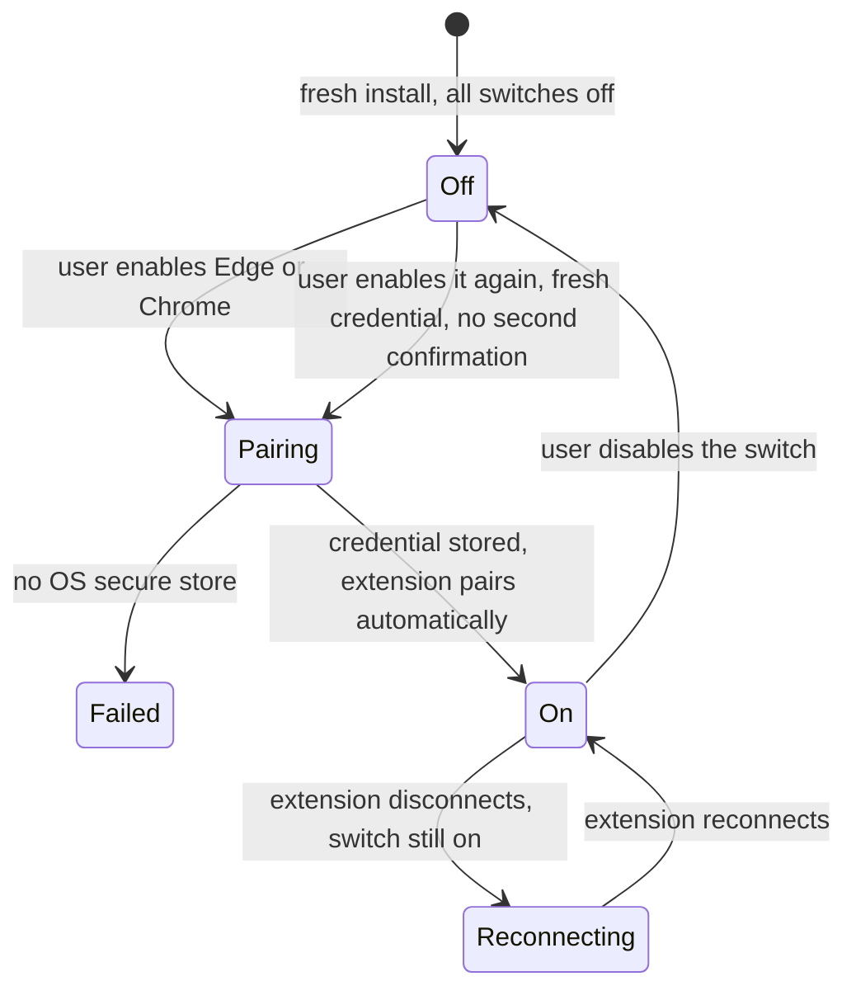

# Pairing credentials

**Status:** This document mixes three kinds of statement, labelled inline:

| Label | Means | Backed by |
| --- | --- | --- |
| `implemented` | The source does this today; the row names the file. | `packages/webui/src/server/browser-bridge/credential-store.ts` and the extension's `src/pairing.ts` |
| `measured` | A probe observed this on the machine named in that section. | `.plan/board/validation/credential-store-evidence.json` |
| `not yet measured` | An open question. Not a denial and not a promise. | Nothing |

The per-OS mechanisms below are `implemented`. Credential-store **availability** is `measured` on one
Linux host and is negative there — and that result is about that host alone.

A pairing credential is what proves the thing connecting to `/browser-bridge` is the extension the user
paired, and not another browser on the same loopback interface. This document owns where that
credential lives, how it rotates, and what happens when the platform offers nowhere safe to put it.

## The store, per OS — what the code actually does

WebUI-side credentials go in the operating system's secure credential store. Extension-side credentials
go in that extension's `chrome.storage.local`. The split is deliberate: the extension runs in the
browser and has no OS store to write to, and the host has no business reading extension storage.

All of this is `implemented` in
`packages/webui/src/server/browser-bridge/credential-store.ts`, selected by the `switch` in
`createPlatformSecureCredentialStore` (`credential-store.ts:132`):

| OS | Mechanism | Command actually run | Availability test |
| --- | --- | --- | --- |
| macOS | login Keychain via the `security` CLI | write: `security add-generic-password -s <service> -a <keyId> -U -w` (value on **stdin**); read: `security find-generic-password -s <service> -a <keyId> -w` | `security help` exits 0 (`credential-store.ts:329`) |
| Linux | freedesktop Secret Service via `secret-tool` | write: `secret-tool store --label=WebUI Browser Bridge service <svc> key <keyId>` (value on **stdin**); read: `secret-tool lookup …`; delete: `secret-tool clear …` | `secret-tool --version` exits 0 (`credential-store.ts:402`) |
| Windows | **DPAPI through PowerShell** — a `ConvertTo-SecureString` / `ConvertFrom-SecureString` round trip. The encrypted blob is written under `%LOCALAPPDATA%\WebUI\browser-bridge\<service>\bridge-<keyId>.blob` | `powershell.exe -NoProfile -NonInteractive -Command <script>`, plaintext in on **stdin** and out on **stdout** (`credential-store.ts:511`) | the script writes `$PSVersionTable.PSVersion.Major`; exit 0 means available (`credential-store.ts:556`) |
| Other / unknown | none | — | `isAvailable()` returns `false`; `save()` throws `BrowserCredentialStoreUnavailableError` |

Three rules the implementation holds on every platform, each stated in the module's own header:

- **The secret never enters a child process's argv.** Every write passes the value on the child's
  stdin. argv is world-readable through the process list, so `security … -w <secret>` or
  `cmdkey /pass:…` would hand the credential to anything that can enumerate processes.
- **What reaches the store is base64 of the raw bytes, never UTF-8 text.** A credential is 32 bytes of
  CSPRNG output and is routinely not valid UTF-8; decoding the saved text back would not return the
  saved bytes. `encodeCredentialForStore` / `decodeCredentialFromStore` (`credential-store.ts:243`,
  `credential-store.ts:256`) make the encoding reversible, and the decoder is strict — a value that is
  not canonical base64 throws, and each `load()` treats that as "no credential".
- **`load()` asks the platform on every call.** No in-process cache answers a load, so a restarted host
  reads whatever the OS store holds.

> **The Windows mechanism changed during this change.** An earlier revision of this store used
> `cmdkey` and the Windows Credential Manager, and had no restart read-back — `cmdkey /list` does not
> return a password, so `load()` answered from an in-process mirror that was empty after a restart.
> The current tree does **not** use `cmdkey`: the module states in a comment at `credential-store.ts:423`
> that `cmdkey` is deliberately not used for exactly that reason, and the store is now a DPAPI round
> trip. The platform mechanisms in this document were under active revision while these documents were
> being written; check `credential-store.ts` before relying on any row above.

The macOS row is the one to read most carefully on a real machine. `security add-generic-password
… -U -w` **with no value operand** makes `security` read the password from stdin; that is what keeps
the secret out of the process list. The earlier `-w <secret>` form did not.

The Linux row's presence on PATH is not sufficient evidence that a store exists. A host can have
`gnome-keyring-daemon` and a D-Bus session bus and still have no Secret Service client, because nothing
installed can speak the protocol. A daemon that cannot be talked to is not a store.

## Measured: unavailable on the one host the probe ran on

`.plan/board/validation/credential-store-evidence.json`, `platform: "linux"`:

| Provider | Field | Value |
| --- | --- | --- |
| `secret-tool` | `providers.secretTool` | `false` |
| `kwallet-query` | `providers.kwallet` | `false` |
| `gnome-keyring-daemon` | `providers.gnomeKeyringDaemon` | `true` |
| D-Bus session bus | `providers.dbusSession` | `true` |
| Overall availability | `available` | `false` |

The evidence's own `reason`: `no Secret Service client (no secret-tool, no kwallet-query) on this host`.

So the host has a keyring daemon and a session bus, and still **no reachable Secret Service client**.
This is the exact case the explicit-failure rule exists for, and the probe was written to establish it
rather than assume it.

### How far that result reaches

It is a statement about **one machine**, and it must not be widened:

| This measurement establishes | It does not establish |
| --- | --- |
| On the host the probe ran on, neither `secret-tool` nor `kwallet-query` was installed, and no Secret Service client answered | Anything about Linux in general — another distribution, desktop or server may ship either client |
| On that host the store was unavailable, so the explicit-failure path is reachable there | Anything about **macOS** or **Windows** — neither was probed, and no probe artifact for them exists |
| A keyring daemon plus a session bus is not by itself evidence of a store | Anything about the *implementation*: the macOS and Windows mechanisms above are `implemented` in source, not `measured` on a host |

No macOS host and no Windows host were probed. Any cross-platform claim about credential-store
availability is unsupported by the evidence in this directory and must not be inferred from the table
above.

The probe also encodes the reachability rule for a client that *is* present: when `secret-tool` exists,
the probe actually runs `secret-tool search service mcode-webui key probe` and records
`available: false` with a distinct reason if the Secret Service does not answer. Presence of the binary
is not sufficient; the store must answer. That branch was **not taken** on the measured host, because
`secret-tool` was not installed.

## The explicit-failure rule

**If no OS secure store is available, pairing fails explicitly. The credential is never written to a
file.**

| Requirement | Detail |
| --- | --- |
| Report | `browser_credential_store_unavailable` — the pinned code at `packages/webui/src/shared/contracts/browser.ts:239` |
| Do not write | No plaintext file, no config-file fallback, no environment variable, no "temporary" file |
| Do not substitute | The existing `packages/oauth-core` file-based credential store is **not** a fallback |
| Do not degrade | The switch may report itself on, but the surface stays unusable and says why |
| Surface the reason | The user is told which store was looked for on their platform and was not found |

The measured host in this document is a host where pairing **fails**. It is not a degraded mode, not a
prompt for a file path, and not a success with a warning.

### The repository has no OS keyring dependency today

This is a build-level fact, not an inference:

| Fact | Where |
| --- | --- |
| `keytar` appears in no `package.json` in this repository | verified across the workspace manifests |
| The OAuth credential store kind is `'file'` | `CredentialStoreKind = 'file'`, `packages/oauth-core/src/credential-store/types.ts:3` |
| `'os-keyring'` exists only as a legacy kind | `LegacyCredentialStoreKind = 'os-keyring'`, `packages/oauth-core/src/credential-store/types.ts:4` |

The composition in `packages/oauth-core/src/credential-store/factory.ts:6` returns a `FileStore`. So the
"OS secure store" path has to be built, and the file store that exists is not it. Reaching a Secret
Service, Keychain or DPAPI means either a new dependency with a stated reason or an owned per-platform
implementation; the repository rule is that a dependency is added only with a reason a review can check.

> **This store is implemented.** `packages/webui/src/server/browser-bridge/credential-store.ts` is in
> the tree and was reviewed while these documents were being corrected. It implements the rule required
> here: `save()` throws `BrowserCredentialStoreUnavailableError` with no file, environment-variable or
> in-memory fallback, `BrowserBridgePairing.issueChallenge()`
> (`packages/webui/src/server/browser-bridge/pairing.ts:152`) calls `isAvailable()` first and raises the
> same error when no store is reachable, and there is no plaintext file path anywhere in the module.
>
> What is **not** implemented is the path that would reach it: `createPlatformSecureCredentialStore`
> has no production caller, and the bridge is not wired into the server's WebSocket upgrade path, so
> pairing cannot currently be exercised end to end from this host. See
> [`07-review-findings.md`](07-review-findings.md), finding F3.

## One credential per browser

Each browser receives a **distinct, high-entropy** credential.

| Rule | Reason |
| --- | --- |
| Edge and Chrome never share a credential | Revoking one must not affect the other; a credential from one browser must not authenticate the other. |
| The isolated surface has no pairing credential | It is a browser this process launches and owns, reached over loopback CDP, not through the bridge. Its gate is the `isolatedChromium` switch. |
| A credential is bound to one `keyId` | The key id is inside the signed material (`nonce + " " + keyId`), so a proof captured for one credential cannot be presented against another. |

High-entropy here means generated by a CSPRNG. The repository already has the right primitive in use
next door: `randomUUID()` from `node:crypto` in `createWebuiCredential`
(`packages/webui/src/server/credentials.ts:19`).

## Lifecycle

| Transition | Effect |
| --- | --- |
| Off → on | A **fresh** credential is created and stored; pairing happens automatically with **no second user confirmation** |
| On → off | Immediate revocation: the server credential is destroyed, active sockets are closed, and **every copy** of the old credential is rejected from that moment |
| On, extension disconnects | The credential is not invalidated. Background reconnect continues while the switch is on |
| Off → on again | A different credential from the first one; the old one stays revoked |

The enabled state and the authorization of each browser survive WebUI and browser restarts. That is
`implemented`: `createBrowserAdapter` (`packages/webui/src/runtime/harness/browser.ts:54`) reads and
writes the four switches through the host's configuration capability rather than through memory, and
the persistence behind that capability lives outside `packages/webui`. Surviving a restart is why the
credential is persisted in the OS store at all — but only there.

`not yet measured` — the extension's automatic reconnect is implemented on both sides
(`packages/browser-extension/src/bridge-client.ts` and
`packages/webui/src/server/browser-bridge/reconnect.ts`) but **unwired**, and no probe observed a
disconnect or a service-worker restart. See [`02-bridge-protocol.md`](02-bridge-protocol.md).

## Two independent gates

The extension's browser permission and the WebUI browser switch are **independent**. Neither implies the
other:

- The extension's permission is granted in the browser's own extension UI.
- The switch is set in WebUI's settings.

Enabling a switch in WebUI does not grant a browser permission, and granting a browser permission does
not authorize the surface in WebUI. Full CDP access is a third, separate gate and never stands in for
either — see [`06-runtime-authorization-trace.md`](06-runtime-authorization-trace.md).

## Handling rules

| Rule | Detail |
| --- | --- |
| Never logged | A credential, a secret or a signature is not written to a log, an error message, a crash report or a diagnostic dump |
| Never replaced by the per-start token | The per-start WebUI connection token is not a pairing credential and must not be reused as one |
| Never echoed in a refusal | An admission failure reports *which* check failed, never the value presented |
| Proofs are not secrets | A proof is bound to a single-use nonce and is useless once that nonce is spent; it is still treated as sensitive material in transit and is not persisted |

The per-start token changes on every service start (`createWebuiCredential`,
`packages/webui/src/server/credentials.ts:19`). Substituting it for a pairing credential would make
pairing impossible across restarts, which is why the two are kept separate by contract rather than by
convention.

## Related

| Concern | Document |
| --- | --- |
| The challenge and proof that consume this credential | [`02-bridge-protocol.md`](02-bridge-protocol.md) |
| Where the credential is presented and what is refused | [`03-extension-admission.md`](03-extension-admission.md) |
| The store availability result in the capability matrix | [`01-capability-matrix.md`](01-capability-matrix.md) |