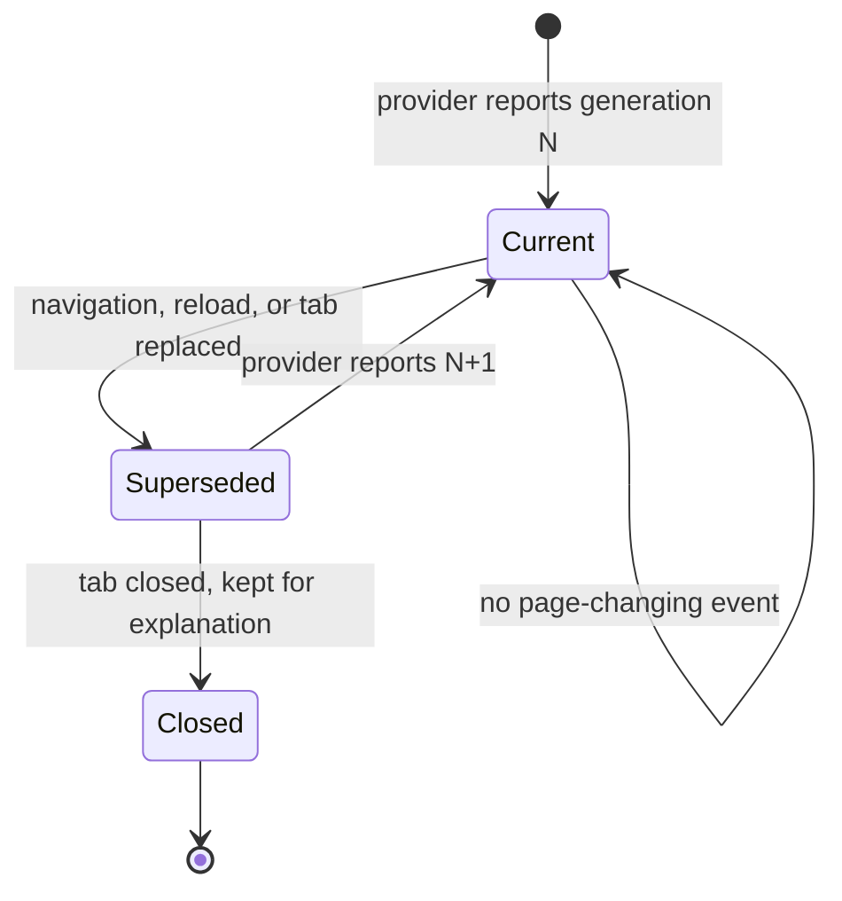

# Target identity, generation and selection

**Status:** This document mixes three kinds of statement, labelled inline:

| Label | Means | Backed by |
| --- | --- | --- |
| `implemented` | The source does this today; the row names the file and line. | `packages/webui/src/runtime/browser/target-registry.ts` |
| `required` | A rule the contracts pin with no enforcing code at that point. | `packages/webui/src/shared/contracts/browser.ts` |
| `not yet measured` | An open question. Not a denial and not a promise. | Nothing |

**The registry exists and its generation is now fed.** `WebuiBrowserTargetRegistry` is implemented in
`packages/webui/src/runtime/browser/target-registry.ts`, `isCurrent` compares the generation
(`target-registry.ts`), and `WebuiBrowserService.#ensureProvider` subscribes to the provider's
`onTargetChanged` and calls `raiseGeneration` (`browser-service.ts:176`), so the counter advances when
the page behind a target is replaced. Finding F2 in
[`07-review-findings.md`](07-review-findings.md) records what this closes and what remains unmeasured.

The panel and the Agent must address the same page. That is only true if both sides name a target the
same way, and if a name recorded against an old page cannot quietly land on the new one. This document
owns that naming.

## The identity

`WebuiBrowserTargetId` is four fields, not one:

| Field | Type | What it distinguishes | Why it is needed |
| --- | --- | --- | --- |
| `surface` | `"isolated-chromium" \| "edge" \| "chrome"` | which browser kind | A target id from Chrome must never be accepted for Edge |
| `browserId` | `string` | which *instance* of that surface | Two Edge windows pairing with the same host, or a relaunched isolated Chromium, both yield tab ids that a browser alone would not distinguish |
| `targetId` | `string` | which tab inside that browser | The tab is what a page lives in |
| `generation` | `number` | which *page* behind that tab | The tab id survives a navigation and a reload, so it alone cannot say the page is the same one |

`isSameWebuiBrowserTarget` compares all four. A mismatch on any one of them is a different target.

The three parts and the generation line up with what can independently go stale: the browser, the tab,
and the page behind the tab.

## Generation

A generation is a monotonic per-target counter. `WEBUI_BROWSER_TARGET_GENERATION_UNSET` is `0`, the
value before a provider has ever reported one.

### What invalidates a generation

| Event | Invalidates | Note |
| --- | --- | --- |
| Navigation to a new document | yes | Including same-document and in-page navigation where the provider can detect it |
| Reload | yes | A reload produces a new document; the tab id is unchanged |
| Target replaced — a tab closed and reopened, or a new tab reused the id | yes | This is the case the `browserId` field alone would not catch |
| Frame replaced or destroyed inside the page | for references bound to that frame | The target itself may stay valid |
| Paint, focus change, scroll, DOM mutation without navigation | no | The page is still the page |
| A *different* tab in the same browser | no for this target | It is a different `targetId` |

The line that matters: **the page behind a tab id changing invalidates the generation; the page's
content changing does not.**

### Why the generation is in the identity

The failure it prevents is a mis-aimed action rather than a failed one. The Agent inspects a page,
receives an element reference, the user clicks something in the panel, the page navigates, and a stale
reference lands on whatever now occupies those coordinates. Nothing in the system would raise an error:
the coordinates were valid and the target existed. Carrying the generation makes the mismatch detectable
before dispatch.

## Rejecting a stale reference

A caller names a target; the host compares the whole identity against the registry and refuses rather
than resolving to the nearest match.

| Situation | Result | Pinned code | State |
| --- | --- | --- | --- |
| Identity matches surface, browser, tab **and** generation | proceed | — | `implemented` — `isCurrent`, `target-registry.ts` |
| Generation is behind the registry's | refuse — the page moved on | `browser_target_stale` | `implemented` — `sendInput` calls `isCurrent` (`browser-service.ts:289`), and the registry's generation is raised from `provider.onTargetChanged` (`browser-service.ts:176`) |
| Surface or browser does not match, or the target is absent | refuse — no such target here | `browser_target_unknown` | `implemented` — `selectTarget`, `browser-service.ts:256` |

**How the registry learns that the page moved.** The provider is the only party that knows when the page
behind a target is replaced, so `#ensureProvider` subscribes to it and forwards the announcement
(`browser-service.ts:176`):

| Counter | Owner | Behaviour |
| --- | --- | --- |
| `WebuiIsolatedChromiumProvider.#generation` | the provider | Starts at 1, increments on a main-frame `Page.frameNavigated`, and is reported in `listTargets` and on every image frame |
| `WebuiBrowserTargetRegistry` entry generation | the registry | Raised through `raiseGeneration` when the provider announces the change |

`observe()` deliberately does **not** raise the generation on a repeat sighting — a provider reports its
target list repeatedly, and raising on every sighting would invalidate every reference the moment the
provider refreshed its list. The registry's counter therefore advances only on a real page replacement,
which is what makes `isCurrent` meaningful.

**`not yet measured`** — no probe or integration run drove a navigation and then observed a refused
input. This check is verified by reading the source, not by watching it fire.

Two rules follow from this and are worth stating separately, because they are where a "helpful"
implementation goes wrong:

- **Never resolve a partial match.** A matching `targetId` under a different `browserId` is a different
  target, not a near miss.
- **Never silently refresh a generation.** If the registry knows the target moved on, a caller holding an
  old generation is told so; the registry does not quietly swap in the new one. Otherwise the caller
  cannot tell that its references died.

A closed target is kept rather than dropped, so that a stale reference is *explainable*
(`WebuiBrowserTargetStatus` is `"open" | "closed"`). Dropping it would turn a diagnosable
`browser_target_stale` into an unexplained `browser_target_unknown`.

### Where this reaches the wire

Every target-bearing message carries the generation, on both sides of the bridge:

| Contract | Field |
| --- | --- |
| `WebuiBrowserImageFrame` | `target: WebuiBrowserTargetId` — generation included, so a client can drop a frame for a page it is no longer showing |
| `WebuiBrowserInputCommand` | `target: WebuiBrowserTargetId` — the command is bound to the page it was aimed at |
| `WebuiBrowserBridgeTarget` | `generation` |
| `WebuiBrowserBridgeImageFrame` | `generation` |
| `WebuiBrowserBridgeInputCommand` | `generation` on every variant |

The bridge projects the four-field identity down to `browserId` + `targetId` + `generation` on the wire,
because the surface and the browser are established by which socket and which allowlisted extension
identity the message arrives on. See [`02-bridge-protocol.md`](02-bridge-protocol.md).

## Selection is scoped to the Agent run / TUN

| Rule | Consequence |
| --- | --- |
| Each Agent run / TUN owns its own target selection | Two concurrent runs select independently |
| One run's selection must not overwrite another's | Selecting a tab in run A does not move run B's target |
| The Agent may choose a different authorized tab each turn | Selection is not pinned for the life of a run |
| **After switching tabs, the Agent must reacquire page elements** | References from the previous tab are dead. This is a caller obligation, enforced by the generation counter making it visible |
| Operations against the same tab are serialized | One writer per tab |
| Operations against different tabs may proceed independently | Concurrency is per tab, not global |

The reacquire rule is stated as a requirement on the caller rather than as a mechanism, because the
generation counter can only report the mismatch — it cannot re-resolve an element reference. A reference
recorded against generation *N* has no meaning at *N+1*, and nothing on the host can reconstruct it.

## The panel follows the active run

There is one browser panel. It shows the target of the **active or focused** Agent run, and it shows
that run's target rather than any other run's.

| Rule | Reason |
| --- | --- |
| The panel projects the active run's selection | The user is watching the run they are looking at, not a different run's tab |
| Changing runs updates the panel | The panel re-reads the newly active run's selection |
| A frame for a target the panel is not showing is dropped | The frame carries its identity, so a stale or out-of-band frame is detectable and is not displayed as if it were the chosen page. **`implemented`** — `WebuiBrowserService.#frameMatchesSelection` (`browser-service.ts:396`) compares all four identity fields and the stream drops non-matching frames (`browser-service.ts:370`); see finding F6 |
| The panel never switches the target itself | Selection belongs to the run; the panel reflects it |

That last row is the distinction that keeps the panel honest. The panel is a projection of another
owner's state. If the panel could select, it would be a second writer on the same per-run selection, and
the run's choice would stop being authoritative.

The frame's `sequence` is a monotonic per-stream counter, so a client can also detect a dropped frame —
a liveness signal that is independent of whether the frame was the right one.

## Related

| Concern | Document |
| --- | --- |
| The identity and generation as wire shapes | [`02-bridge-protocol.md`](02-bridge-protocol.md) |
| Which switch must be on before any of this runs | [`06-runtime-authorization-trace.md`](06-runtime-authorization-trace.md) |